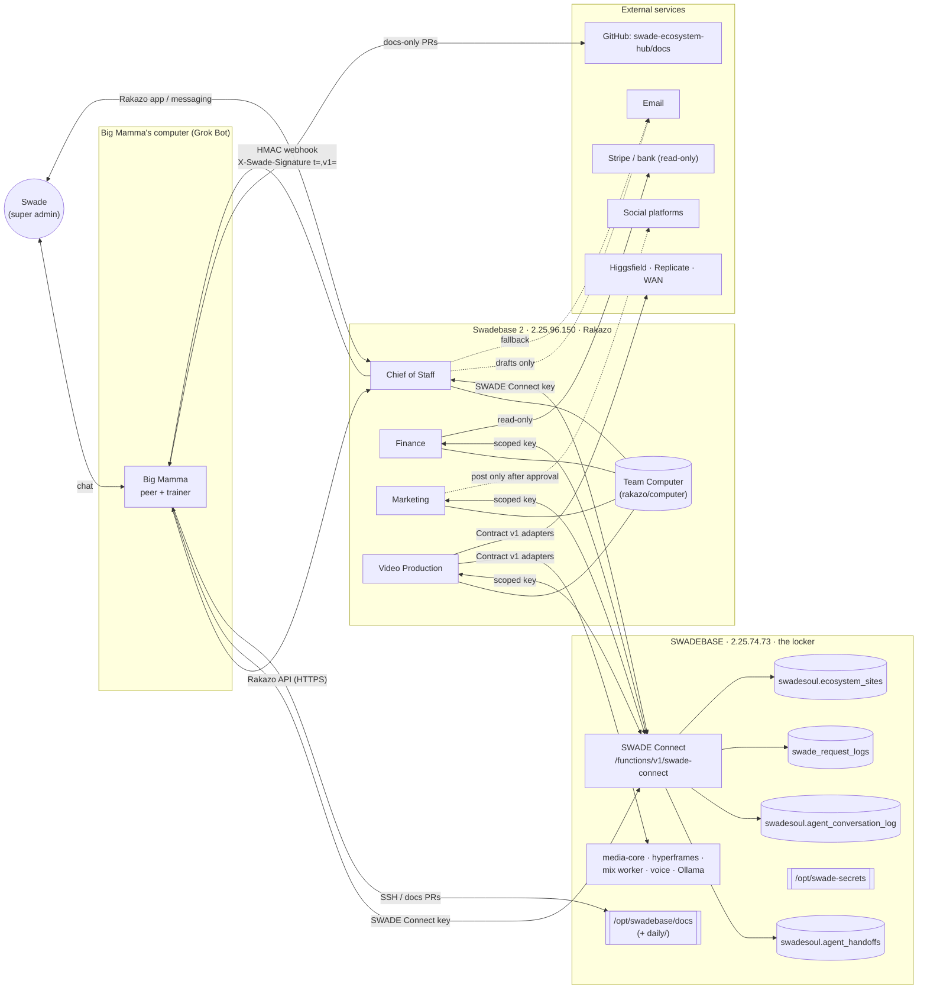

# SWADE Multi-Bot System

**Status:** Design v1, 2026-10-24, not yet built.
**Owner:** Swade Soul (super admin).
**Canonical locations:** `/opt/swadebase/docs/SWADE_MULTI_BOT_SYSTEM.md` on SWADEBASE and `docs/SWADE_MULTI_BOT_SYSTEM.md` in `swadesoul/swade-ecosystem-hub`.
**Related:** [STANDING_RULES.md](STANDING_RULES.md), [SWADE_ADAPTER_CONTRACT_V1.md](SWADE_ADAPTER_CONTRACT_V1.md), SWADE Connect README (`/opt/swadebase/docker/volumes/functions/swade-connect/README.md`), daily summaries in [daily/](daily/) (`daily/INDEX.md`).

This document contains no secret values. Credentials are named only; values live in `/opt/swade-secrets` on SWADEBASE (mode 600) or in Rakazo bot secrets loaded from there.

---

## Table of contents

0. [Standing rules](#0-standing-rules)
1. [Vision](#1-vision)
2. [Bot roles](#2-bot-roles)
3. [Communication](#3-communication)
4. [Self-maintenance](#4-self-maintenance)
5. [Adding new bots](#5-adding-new-bots)
6. [Per-site agents: capacity research and recommendation](#6-per-site-agents-capacity-research-and-recommendation)
7. [Open decisions for Swade](#7-open-decisions-for-swade)
- [Appendix A: Proposed SQL](#appendix-a-proposed-sql)
- [Appendix B: Raw measurements (2026-10-24)](#appendix-b-raw-measurements-2026-10-24)

---

## 0. Standing rules

The full, numbered list is canonical in **[STANDING_RULES.md](STANDING_RULES.md)** (SWADEBASE `/opt/swadebase/docs/STANDING_RULES.md` and hub `docs/STANDING_RULES.md`). If this section and that file ever differ, STANDING_RULES.md wins. The rules this design depends on most:

### 0.1 Rules specific to the multi-bot system (Swade, Oct 24, 2026)

| # | Rule | What it means here | Where it applies |
|---|---|---|---|
| R1 | **Bot rollout and training.** Big Mamma starts with the Chief of Staff bot first and trains it as work progresses. When Swade asks for another bot, Big Mamma engages with it directly and makes sure it is set up, connected and working (it passes its test period) before it is considered `ready`. | Only one bot (Chief of Staff) is built first. No other bot is `ready` until Big Mamma has run its test period and recorded the result. | [§2](#2-bot-roles), [§5](#5-adding-new-bots) |
| R2 | **Replacement-knowledge rule.** Any AI that temporarily replaces Big Mamma (OpenAI, Claude or any other model or agent) has the same knowledge base and rules, so work continues without loss. | See [§3.9](#39-replacing-big-mamma-knowledge-and-capability-parity). | [§3.9](#39-replacing-big-mamma-knowledge-and-capability-parity) |
| R3 | **Replacement capability parity.** The replacement also has the same *capabilities* to talk to the Chief of Staff and every other bot: same tools, same channels (signed webhooks, Rakazo API, handoff log), same access levels, never broader. | The "Big Mamma role" credential bundle, transferable only with Swade's approval. | [§3.9](#39-replacing-big-mamma-knowledge-and-capability-parity), [§4.5](#45-key-scoping) |
| R4 | **Daily summary.** Each day's work is saved to `/opt/swadebase/docs/daily/YYYY-MM-DD.md` and hub `docs/daily/` (index `INDEX.md`), plus a `daily_summary` row in the handoff log. | Big Mamma's nightly routine (~11:45 PM CT) writes it; the Chief of Staff reads it every morning before its first routine. | [§3.7](#37-daily-summary-flow), [§2.1](#21-chief-of-staff-cos) |
| R5 | **No silos.** Conversation history and daily summaries are shared through the handoff log on SWADEBASE, readable by every authorized component (CoS, Big Mamma, Rakazo, all bots). | `swadesoul.agent_handoffs` + `swadesoul.agent_conversation_log`. | [§3.3](#33-shared-handoff-log), [§3.8](#38-shared-conversation-log-no-silos) |

### 0.2 Standing rules (ecosystem-wide)

1. **SWADEBASE is the single locker** for env vars, keys, auth and shared components. No Supabase cloud. No Lovable UI. GitHub is the source of truth for code.
2. **Deploy only what Swade approved.** Bots may prepare, test and stage; they do not deploy unapproved work.
3. **No outgoing messages without approval.** Every email, DM, post or message to anyone other than Swade and the bot team needs Swade's approval (or a standing rule Swade granted in writing, recorded in the handoff log).
4. **iPad Safari uploads must work** in every upload flow of every build.
5. **resinglab.com's interactive scroll** (and cinematic look) is only ever improved, never removed, replaced or downgraded.
6. **Side-by-side adapter rule** (SWADE Adapter Contract v1 §0): keep old fields and signatures during the switch, convert one tool at a time, set `ready` only after a full test.

---

## 1. Vision

A small team of always-on bots runs under **Rakazo on Swadebase 2** (https://swadebase-2.swadebase.cloud). **Big Mamma** (Swade's Grok Bot assistant, with its own computer) is a **peer** of that team, not its boss and not its subordinate:

- Swade can talk to **either** Big Mamma **or** the Chief of Staff. Whatever one is told, the other learns through instruction mirroring ([§3.6](#36-instruction-mirroring-staying-in-sync)).
- The Chief of Staff coordinates the Rakazo bots day to day. Big Mamma builds, trains and double-checks them, and does the heavy engineering (SSH, GitHub, cloud coding agents, deep research).
- **SWADEBASE** (2.25.74.73) stays the single locker: credentials, the site registry, the handoff log and the conversation log all live there and are reached through **SWADE Connect** keys.
- Nothing irreversible (sending, posting, deploying, moving money, deleting, DNS) happens without Swade's approval.



---

## 2. Bot roles

Rollout order follows **R1**: Chief of Staff first; the others only when Swade asks, each set up and verified by Big Mamma ([§5](#5-adding-new-bots)).

**Model tiers used below**

| Tier | Meaning | Example today |
|---|---|---|
| T0 local | Free, on SWADEBASE Ollama. Classification, tagging, short summaries. Weak at tool use. | `qwen3:4b`, `llama3.2:3b` |
| T1 economy | Cheap paid model via OpenRouter; good tool use. Default for routines. | `openai/gpt-6-luna` (Moxie, measured ≈ $0.002–0.008 per routine run) |
| T2 premium | Strong reasoning/judgment, used only for review steps (ad quality, finance reconciliation, double-checks). | a frontier model via OpenRouter (Swade to choose; [§7](#7-open-decisions-for-swade)) |

Common to every bot: its own SWADE Connect key with minimum scopes ([§4.5](#45-key-scoping)); reads the daily summary and the open handoffs on wake; writes every action to the handoff log; never sends, posts, deploys, pays, deletes or touches DNS without approval; never prints or stores secret values in chat, memory or logs.

### 2.1 Chief of Staff (CoS)

| Item | Design |
|---|---|
| **Mission** | Swade's operating partner inside Rakazo. Knows every site, campaign and promotion; coordinates the other bots; peers with Big Mamma for double-checks; judges video ad quality; triages email into drafts. |
| **Daily duties** | 1) ~7:30 AM CT: read yesterday's daily summary (`docs/daily/YYYY-MM-DD.md` / `daily_summary` handoff row) and open handoffs. 2) Morning brief to Swade: priorities, approvals waiting, site health (from `ecosystem_sites.last_health_status`), campaign status. 3) Dispatch tasks to Finance / Marketing / Video. 4) Review outputs (ad quality rubric: story hook in first 2 s, brand consistency, cinematic grade, audio mix, captions, aspect ratios, no artifacts). 5) Email triage: label, summarize, draft replies (never send). 6) Evening: hand the day's state to Big Mamma for the nightly summary. |
| **Tools / connectors** | Rakazo built-ins (shell, browser, files, routines, tasks); SWADE Connect (sites, handoffs, conversation log, request logs); email read + draft; read access to campaign calendars and the per-site playbooks ([§6.5](#65-per-site-playbooks)); webhook sender to Big Mamma. |
| **Credentials (names only)** | `SWADE_CONNECT_KEY_COS`, `BIG_MAMMA_WEBHOOK_URL`, `BIG_MAMMA_WEBHOOK_SECRET` (whsec), `COS_EMAIL_READ_DRAFT_TOKEN`, `OPENROUTER_API_KEY` (space-level). All sourced from SWADEBASE `/opt/swade-secrets`, loaded into Rakazo bot secrets. |
| **Model tier** | T1 for routines and triage; T2 for ad-quality reviews and double-checks. |
| **Routines** | Morning brief 7:30 AM CT; midday approvals check 12:30 PM CT; evening handoff 9:00 PM CT; weekly campaign review Mon 9:00 AM CT. |
| **Approval gates** | Any outgoing email/message; any post; any change to a campaign budget; asking another bot to do a gated action (the gate travels with the task). |
| **Never** | Send email or messages on its own; deploy; spend; change DNS; grant keys; mark another bot `ready` (only Big Mamma after the test period, R1); remove or downgrade resinglab.com's interactive scroll. |

### 2.2 Finance

| Item | Design |
|---|---|
| **Mission** | Run the whole money picture: Stripe accounts, bank (read-only), subscriptions, invoices, revenue reports, cost tracking (including model/token and video-credit spend). |
| **Daily duties** | Pull Stripe balances, charges, payouts, disputes, failed payments; reconcile against bank (read-only); flag renewals due in 14 days; track per-site revenue and per-bot AI cost; draft invoices; weekly and monthly P&L by site. Takes over Moxie's "Daily money loop". |
| **Tools / connectors** | Stripe (restricted read keys per account; write only for drafting invoices if Swade approves); bank via read-only aggregator or CSV export; SWADE Connect (sites, handoffs, `usage_records` export from Rakazo); spreadsheet/report output to `docs/finance/` or a private store. |
| **Credentials (names only)** | `SWADE_CONNECT_KEY_FINANCE`, `STRIPE_RESTRICTED_READ_<ACCOUNT>` (one per Stripe account), `BANK_READONLY_TOKEN`, `OPENROUTER_API_KEY`. |
| **Model tier** | T1 for pulls and reports; T2 for monthly reconciliation and anomaly review. |
| **Routines** | Daily money loop 8:00 AM CT (existing Moxie slot); weekly revenue report Mon 8:30 AM CT; monthly close 1st of month 9:00 AM CT. |
| **Approval gates** | Every money movement, refund, payout change, subscription cancel/upgrade/downgrade, invoice send, price change. |
| **Never** | Move money, refund, cancel or change any subscription, change bank details, or send an invoice without explicit approval. Never holds bank write credentials. |

### 2.3 Marketing

| Item | Design |
|---|---|
| **Mission** | Daily marketing across the ecosystem: find unique promotion places, run social media, and produce video ads at top cinematic quality (Higgsfield or similar, via Video Production). |
| **Daily duties** | Content calendar per site; scout new promotion venues (niche communities, newsletters, directories, podcasts, events) with a short fit score; draft posts and captions; brief Video Production on ads; collect performance metrics; propose next experiments. |
| **Tools / connectors** | X and other social connectors (read + draft; post only via approval or standing rule); browser research; SWADE Connect (sites, playbooks, handoffs); Video Production via handoffs. |
| **Credentials (names only)** | `SWADE_CONNECT_KEY_MARKETING`, `X_POSTING_TOKEN_<ACCOUNT>` (held but gated), `<PLATFORM>_TOKEN_<SITE>`, `OPENROUTER_API_KEY`. |
| **Model tier** | T1 for drafting and scouting; T2 for final ad scripts and the CoS-reviewed shortlist. |
| **Routines** | Daily social plan 9:00 AM CT; promotion-venue scout Tue/Thu 10:00 AM CT; weekly metrics Fri 4:00 PM CT. |
| **Approval gates** | Posting (unless Swade grants a standing rule for a specific account + content type, recorded as a `standing_grant` handoff); any paid promotion; any outreach message to a person. |
| **Never** | Post, DM, comment or reach out without approval/standing grant; buy ads; use a site's brand on another site; change a site's front page (and never downgrade resinglab.com's scroll). |

### 2.4 Video Production

| Item | Design |
|---|---|
| **Mission** | One "video connector" to every video program, plus a **video room** where jobs, renders, reviews and approvals live. All adapters follow SWADE Adapter Contract v1. |
| **Video room** | A Rakazo channel/board for video jobs + a `video_jobs` view over the handoff log (`kind = 'video_job'`): brief → storyboard → renders → CoS quality review → Swade approval → deliverables. Assets stored in media-core / SWADEBASE storage, never in a bot's computer only. |
| **Adapters (Contract v1)** | Higgsfield, Replicate, WAN (as used by SSS Brain video production), `sssbrain-render-worker`, `swadebase-hyperframes`, `media-core`, VideoSayWhat Re-Voice/dubbing. Each exposes `status`, the job envelope (§4), and signed callbacks (§5). Conversion follows the side-by-side rule: one tool at a time, old fields kept, `ready` only after a full test. |
| **Daily duties** | Pick up video jobs; choose engine per brief; run renders; check outputs (resolution, frame rate, artifacts, lip-sync, loudness); deliver to CoS for quality review; track credit spend and report to Finance. |
| **Credentials (names only)** | `SWADE_CONNECT_KEY_VIDEO`, `HIGGSFIELD_API_KEY`, `REPLICATE_API_TOKEN`, `WAN_API_KEY`, `MEDIA_CORE_SERVICE_TOKEN`, `HYPERFRAMES_SERVICE_TOKEN`, `RENDER_WORKER_TOKEN`, `VSW_DUBBING_TOKEN`, adapter callback `whsec_*`. |
| **Model tier** | T1 to orchestrate; T2 for storyboard/script polish. Generation cost is in the video engines, not the LLM. |
| **Routines** | Job queue sweep every 2 h (8 AM–10 PM CT); nightly render-cost report 10:30 PM CT. |
| **Approval gates** | Any render above a per-job credit ceiling (Swade to set); publishing anything; enabling a new paid engine. |
| **Never** | Publish; exceed the credit ceiling; switch an adapter to `ready` before its full test; store final assets only inside the Rakazo computer. |

---

## 3. Communication

### 3.1 Channels at a glance

| From → To | Channel | Auth | Use |
|---|---|---|---|
| CoS/any bot → Big Mamma | HTTPS POST to Big Mamma's inbound webhook | HMAC `X-Swade-Signature: t=<unix>,v1=<hex>` per Contract v1 §5 | Wake Big Mamma: double-check requests, escalations, engineering tasks |
| Big Mamma → CoS/any bot | Rakazo API over HTTPS (`https://swadebase-2.swadebase.cloud`) | Rakazo API token for Big Mamma's role | Send tasks/messages, start runs, read results |
| Everyone ↔ shared state | SWADE Connect → `swadesoul.agent_handoffs`, `swadesoul.agent_conversation_log` | Per-agent SWADE Connect key (`X-SWADE-API-KEY`) | Durable task state, results, audit, conversation summaries |
| Fallback | Email to Big Mamma's own inbox / Swade | Mailbox auth | Only when webhook and Rakazo API are both failing |

### 3.2 Signed webhooks (CoS → Big Mamma)

Exactly as Contract v1 §5:

- Headers: `X-Swade-Signature: t=<unix_seconds>,v1=<hex>`, `X-Swade-Event: handoff.created | handoff.updated | doublecheck.request | escalation`, `X-Swade-Delivery: <uuid>`, `User-Agent: rakazo-<bot>/<version>`.
- `v1 = hex(HMAC-SHA256(secret, "<t>." + raw_body))`; receiver rejects `|now − t| > 300 s`, compares in constant time, de-duplicates on `X-Swade-Delivery`.
- Body is thin: `{ "handoff_id": "...", "kind": "...", "summary": "..." }`. The full payload lives in the handoff log, so a leaked webhook body reveals little and the receiver always reads the authoritative row.
- Retries: 1 s, 5 s, 30 s on network error or 5xx; 4xx is final.

### 3.3 Shared handoff log

Proposed table **`swadesoul.agent_handoffs`** on SWADEBASE (DDL in [Appendix A](#appendix-a-proposed-sql)):

| Column | Type | Notes |
|---|---|---|
| `id` | uuid PK | |
| `from_agent` | text | `big-mamma`, `cos`, `finance`, `marketing`, `video`, `swade`, `replacement:<name>` |
| `to_agent` | text | same set, or `*` for broadcast |
| `kind` | text | `task`, `doublecheck`, `result`, `instruction_mirror`, `approval_request`, `approval_decision`, `standing_grant`, `daily_summary`, `video_job`, `incident`, `heartbeat` |
| `payload` | jsonb | task details; never secret values |
| `status` | text | `queued → claimed → in_progress → done / failed / cancelled / needs_approval` |
| `result` | jsonb | outcome, links, evidence |
| `parent_id` | uuid | thread of related handoffs |
| `hop_count` | int | loop prevention |
| `idempotency_key` | text UNIQUE (with `from_agent`) | |
| `site_slug` | text | optional, from `ecosystem_sites` |
| `claimed_by`, `claimed_at`, `due_at` | | claim/lease |
| `created_at`, `updated_at` | timestamptz | |

Access only through SWADE Connect (new routes, e.g. `GET/POST /v1/handoffs`, `PATCH /v1/handoffs/:id`), with scopes `handoffs:read`, `handoffs:write:own` (rows where `from_agent` = caller), `handoffs:claim` (rows where `to_agent` = caller). Every call is logged in `swadesoul.swade_request_logs`.

### 3.4 Double-check protocol

Used for anything gated or high-impact (ad approval packages, finance reports, deploy proposals, outgoing drafts):

1. Maker bot finishes work and writes `kind = 'result'`, `status = 'needs_approval'` or `'done'`.
2. Maker writes `kind = 'doublecheck'` to the peer (CoS ↔ Big Mamma; Big Mamma checks the CoS's own work, the CoS checks the other bots' work and Big Mamma's bot-facing changes).
3. Checker re-derives key facts independently (re-reads source data, re-runs the test, re-views the video) and writes `result = { verdict: pass | fail | concerns, notes, evidence }`.
4. Only `pass` items go to Swade as an approval request. `fail` goes back to the maker with notes (counts as one hop).
5. Disagreement after one round → escalate to Swade with both views. No third round.

### 3.5 Loop prevention and idempotency

- **Hop limit:** each handoff carries `hop_count`; children get `parent.hop_count + 1`; at 5 the handoff is forced to `needs_approval` and Swade is told.
- **No echo:** an agent never creates a handoff in reply to its own `instruction_mirror` or `result`; mirrors are informational and never trigger a run by themselves.
- **One open double-check per item:** unique partial index on (`parent_id`, `kind`) where `kind='doublecheck' and status in ('queued','in_progress')`.
- **Rate cap:** per-agent max handoffs per hour (SWADE Connect key rate limit, default 60/min, set lower for bots, e.g. 30/hour on `handoffs:write`).
- **Idempotency:** writers set `idempotency_key` (e.g. `cos:morning-brief:2026-10-25`); a repeat insert returns the existing row. Webhook receivers de-duplicate on `X-Swade-Delivery`. Claims use `UPDATE … WHERE status='queued' RETURNING` so two agents cannot both claim.
- **Stuck runs:** anything `in_progress` past `due_at` (default 30 min) is marked `failed` with reason `timeout` and reported. (Measured: Moxie's 10-18 routine run sat ≈ 24 h before cancellation; this guard prevents a repeat.)

### 3.6 Instruction mirroring (staying in sync)

Swade may talk to either peer. When either receives a **standing instruction, preference, decision or approval** from Swade, it writes `kind = 'instruction_mirror'` (to `*`) with the instruction text/summary, scope (site, bot, duration) and source (`chat:big-mamma`, `rakazo:cos`). The other peer reads mirrors on every wake and updates its own memory/skills. Approvals are mirrored as `approval_decision` so a send approved in one place is not re-asked in the other. Standing rules are also appended to STANDING_RULES.md by Big Mamma (docs-only PR) so they survive any agent change.

### 3.7 Daily summary flow

| Time (CT) | Who | What |
|---|---|---|
| ~9:00 PM | CoS | Evening handoff: day's state of the Rakazo team (`kind='result'`, to `big-mamma`). |
| ~11:45 PM | Big Mamma (nightly routine) | Writes `/opt/swadebase/docs/daily/YYYY-MM-DD.md`, updates `daily/INDEX.md`, mirrors both to hub `docs/daily/`, and inserts a `kind='daily_summary'` handoff (to `*`) with the path and a short summary. |
| ~7:30 AM | CoS | Reads the latest `daily_summary` row and file before the morning brief; every other bot reads it on its first run of the day. |

### 3.8 Shared conversation log (no silos)

Proposed table **`swadesoul.agent_conversation_log`** (DDL in [Appendix A](#appendix-a-proposed-sql)): `id, agent, channel, role, summary, text, refs, site_slug, handoff_id, visibility, created_at, expires_at`.

| Field | Meaning |
|---|---|
| `agent` | who logged it (`big-mamma`, `cos`, …) |
| `channel` | `grok-chat`, `rakazo-chat`, `rakazo-routine`, `email`, `x`, `webhook` |
| `role` | `swade`, `agent`, `other_bot`, `external` |
| `summary` | always present, ≤ 1,000 chars, written by the agent |
| `text` | optional verbatim excerpt (only for Swade↔agent instructions), ≤ 8 KB |
| `refs` | jsonb links: handoff ids, PRs, files, thread ids |
| `visibility` | `team` (all authorized agents), `restricted` (Big Mamma + CoS + Swade) |

**Retention and privacy rules**

1. Summaries by default; verbatim `text` only for instructions from Swade. No third-party message bodies verbatim: external email/DM content is summarized (sender domain, topic, action), never copied in full.
2. **Never** store secrets, passwords, OTPs, card or bank numbers, or API keys. Writers run a redaction pass (key/token/card patterns) before insert; SWADE Connect rejects rows that match secret patterns.
3. Finance details (amounts per customer, bank lines) are `restricted`.
4. Retention: `text` purged after 90 days; `summary` kept 1 year; `daily_summary` handoffs and the daily files are kept indefinitely (they are the long-term memory). A nightly job sets `text = null` past `expires_at`.
5. Read scope `convlog:read` for every authorized agent; `convlog:read:restricted` only for Big Mamma, CoS and Swade; write scope `convlog:write:own`. All reads logged in `swade_request_logs`.
6. Swade can request deletion of any row; deletion is itself logged (row id + who + when, no content).

### 3.9 Replacing Big Mamma: knowledge and capability parity

Rules R2 and R3. A replacement (OpenAI, Claude, any model or agent) must be able to carry on **without loss** and **talk to every bot exactly as Big Mamma does**, with **the same approval gates** and **never broader powers**.

**Knowledge (R2): required reading set, in order**

1. `STANDING_RULES.md`
2. `SWADE_MULTI_BOT_SYSTEM.md` (this file)
3. `SWADE_ADAPTER_CONTRACT_V1.md`
4. SWADE Connect README (`/opt/swadebase/docker/volumes/functions/swade-connect/README.md`)
5. `daily/INDEX.md` and the last 7 daily summaries
6. Open rows in `swadesoul.agent_handoffs` (`status not in ('done','cancelled')`) and recent `instruction_mirror` / `standing_grant` rows — the in-flight work state

Canonical knowledge: `/opt/swadebase/docs/` on SWADEBASE and `docs/` in `swadesoul/swade-ecosystem-hub` (kept identical; hub is reviewed via docs-only PRs).

**Capability (R3): the "Big Mamma role" credential bundle**

| Credential (name only) | Gives | Where stored |
|---|---|---|
| `SWADE_CONNECT_KEY_BIG_MAMMA_ROLE` | Handoffs read/write/claim, conversation log read (incl. restricted)/write, sites read, request-log read, key-request submit (not approve) | `/opt/swade-secrets/big-mamma-role.env` |
| `BIG_MAMMA_WEBHOOK_SECRET` | Verify inbound bot webhooks (`whsec_…`) | same file |
| `BIG_MAMMA_WEBHOOK_URL` | Where bots wake "Big Mamma" (the role, not the product) | same file + each bot's Rakazo secrets |
| `RAKAZO_API_TOKEN_BIG_MAMMA_ROLE` | Send tasks/messages to bots, start runs, read results in the Swade space | same file |
| `SSH_KEY_BIG_MAMMA_ROLE` (path ref only) | SSH to SWADEBASE and Swadebase 2 for read/test; changes still gated | `/opt/swade-secrets/` reference; key file on the agent's machine |
| `GITHUB_TOKEN_BIG_MAMMA_ROLE` | Docs PRs to the hub; code PRs; merges only when Swade approved | same file |

**Transfer procedure (requires Swade's approval each time)**

1. Swade approves the handover (who, from when, until when) → recorded as `approval_decision` in the handoff log.
2. Prefer **issuing, not copying**: Big Mamma (or Swade) files an access request in the SWADE Connect approval queue for a `replacement:<name>` key with **exactly** the Big Mamma role scopes and an expiry; Swade approves.
3. The webhook is repointed: `BIG_MAMMA_WEBHOOK_URL` in each bot's Rakazo secrets is updated to the replacement's inbound endpoint, and a fresh `BIG_MAMMA_WEBHOOK_SECRET` is issued (bots get the new secret in their Rakazo secrets).
4. A Rakazo API token is issued for the replacement (or the role token is rotated and handed over).
5. The replacement runs a smoke test: read the required reading set, read open handoffs, send one `heartbeat` to the CoS via Rakazo API, receive one signed webhook back.
6. On hand-back: revoke the replacement key, rotate webhook secret and Rakazo token, repoint the webhook URL, log `kind='incident'`/`handover_closed` with what changed.

The replacement is bound by the same gates as everyone ([§4.1](#41-approval-gates)); its key cannot approve keys, and it never receives scopes Big Mamma lacks.

---

## 4. Self-maintenance

### 4.1 Approval gates

| Action class | Examples | Gate |
|---|---|---|
| Sends | email, DM, SMS, post, comment, outreach | Swade approval or a recorded `standing_grant` (specific account + content type + expiry) |
| Deploys | code, edge functions, containers, Coolify apps, config | Swade approval; then merge, deploy, report |
| Money | refunds, payouts, subscription changes, purchases, ad spend, credit top-ups | Swade approval every time |
| Deletes | files, rows, repos, bots, containers, media | Swade approval |
| DNS / domains | records, nameservers, SSL changes | Swade approval |
| Keys | issuing/broadening SWADE Connect keys | Approval queue, super admin only |
| Bot readiness | setting a bot or adapter `ready` | Big Mamma after a passed test period (R1); Swade informed |

### 4.2 Side-by-side adapter rule and test-before-ready

Adapters (Contract v1 §0): old fields and signatures kept while switching; one tool converted at a time; `ready` only after a full test (status, sync action, async job + signed callback, error path, iPad Safari upload where an upload exists). Bots follow the same lifecycle: `draft → testing → ready → paused → retired`.

### 4.3 Health checks and status

- Each bot writes a `heartbeat` handoff after every routine run (`result.ok`, run seconds, tokens, cost).
- CoS morning brief includes: missed heartbeats, failed/stuck handoffs, Rakazo container health, `ecosystem_sites.last_health_status`.
- Big Mamma checks weekly: Swadebase 2 memory/swap, Rakazo containers healthy, computer container exits cleanly after runs, disk free > 20%.

### 4.4 Audit trail

Every action leaves two records: the handoff row (what/why/result) and the SWADE Connect request in `swadesoul.swade_request_logs` (who/when/route). Rakazo's own `runs`, `usage_records`, `events` and `external_effects` tables are the third, local record.

### 4.5 Key scoping

| Agent | SWADE Connect key | Scopes (minimum) |
|---|---|---|
| Big Mamma (role) | `SWADE_CONNECT_KEY_BIG_MAMMA_ROLE` | `handoffs:*`, `convlog:read:restricted`, `convlog:write:own`, `sites:read`, `logs:read`, `keys:request` |
| CoS | `SWADE_CONNECT_KEY_COS` | `handoffs:read`, `handoffs:write:own`, `handoffs:claim`, `convlog:read:restricted`, `convlog:write:own`, `sites:read` |
| Finance | `SWADE_CONNECT_KEY_FINANCE` | `handoffs:read:own`, `handoffs:write:own`, `handoffs:claim`, `convlog:read`, `convlog:write:own`, `sites:read`, `finance:*` (read) |
| Marketing | `SWADE_CONNECT_KEY_MARKETING` | `handoffs:read:own`, `handoffs:write:own`, `handoffs:claim`, `convlog:read`, `convlog:write:own`, `sites:read` |
| Video | `SWADE_CONNECT_KEY_VIDEO` | `handoffs:read:own`, `handoffs:write:own`, `handoffs:claim`, `convlog:read`, `convlog:write:own`, `sites:read`, `media:jobs` |
| Replacement | `replacement:<name>` | identical to Big Mamma role, with expiry |

Keys are issued only through the SWADE Connect access-request approval queue (super admin). Keys are own-site-only where site-bound. Rotate every 90 days or on any handover.

### 4.6 Cost controls

- Default T1 model; T2 only on named steps. T0 (Ollama) for classification/summaries where quality is enough.
- Per-bot monthly budget in Rakazo/OpenRouter; Finance reports actuals from Rakazo `usage_records.costUsd` daily.
- Video-engine credit ceiling per job and per week (Swade sets).
- Routines are staggered (never two heavy routines at the same minute) to keep a single team computer busy at a time ([§6](#6-per-site-agents-capacity-research-and-recommendation)).

### 4.7 Incident and rollback

1. Detect (failed heartbeat, stuck handoff, error spike in `swade_request_logs`).
2. Contain: pause the bot's routines in Rakazo; revoke/suspend its SWADE Connect key if behaving wrongly.
3. Record `kind='incident'` with timeline.
4. Roll back: adapters fall back to the old field/signature path (kept by the side-by-side rule); bot config restored from the previous revision; deploys rolled back only with Swade's approval.
5. Post-incident note in the daily summary.

---

## 5. Adding new bots

Rule R1: Big Mamma engages with every new bot directly and it is not `ready` until it passes its test period.

| Step | Action | Who | Done when |
|---|---|---|---|
| 1 | **Define the role**: mission, duties, tools, credentials (names), model tier, routines, gates, "never" list (use the §2 template). | Big Mamma, Swade approves | Role section merged into this doc (docs-only PR) |
| 2 | **Create the bot in Rakazo** (Swade's space, team computer by default; dedicated computer only if isolation is needed). Set model, memory, skills. | Big Mamma | Bot exists, status `draft` |
| 3 | **Issue a scoped SWADE Connect key** via the access-request approval queue. | Big Mamma requests, Swade approves | Key stored in `/opt/swade-secrets/<bot>.env` and Rakazo bot secrets |
| 4 | **Connect tools** (MCP servers / connectors / Contract v1 adapters), with gated tokens held but blocked by approval rules. | Big Mamma | Each tool's status check passes |
| 5 | **Add to the handoff log and conversation log** (agent name, scopes, webhook URL/secret to Big Mamma). | Big Mamma | Bot can claim a test handoff and write a heartbeat |
| 6 | **Test period** (≥ 3 days of routines + scripted tests: gated action correctly stops for approval, double-check round-trip, idempotent re-run, loop guard, iPad Safari upload where relevant). | Big Mamma + CoS | All tests pass, recorded in a `result` handoff |
| 7 | **Set `ready`** and announce in the daily summary. | Big Mamma | Status `ready`; Swade informed |

---

## 6. Per-site agents: capacity research and recommendation

Measured 2026-10-24 ~1:56 AM CT. Full numbers in [Appendix B](#appendix-b-raw-measurements-2026-10-24).

### 6.1 The two servers

| | SWADEBASE (2.25.74.73) | Swadebase 2 (2.25.96.150) |
|---|---|---|
| vCPU | 8 (AMD EPYC 9354P) | **2** (AMD EPYC 9354P) |
| Load (1/5/15 min) | 1.90 / 1.80 / 1.50 | 0.32 / 0.47 / 0.50 |
| RAM total / used / available | 32,094 / 12,784 / **19,310 MB** | 7,940 / 4,620 / **3,320 MB** |
| Swap used | 254 / 4,095 MB | **3,735 / 4,095 MB (91%)** |
| Disk `/` | 387 G, 156 G used, **231 G free** (41%) | 96 G, 61 G used, **35 G free** (64%) |
| Running containers | 62 | 17 |
| Top consumers | supabase-kong 1.17 GiB, azuracast 693 MiB, vsw-warp 580 MiB, edge-functions 539 MiB, mailcow stack, supabase-db 287 MiB | voicebox 1.14 GiB, sssbrain-stt 642 MiB, rakazo-api 568 MiB, coolify 416 MiB, rakazo-worker 278 MiB |

### 6.2 Rakazo footprint on Swadebase 2

| Container | Memory now | Memory limit |
|---|---|---|
| rakazo-api-1 | 568 MiB | 1.5 GiB |
| rakazo-worker-1 | 278 MiB | 2 GiB |
| rakazo-supervisor-1 | 54 MiB | 512 MiB |
| rakazo-web-1 | 43 MiB | 512 MiB |
| rakazo-postgres-1 | 57 MiB (DB 13 MB) | 2 GiB |
| **Core total** | **≈ 1.0 GiB** | 6.5 GiB |
| Team computer (`rakazo-bot-team-…`, `rakazo/computer:edge`) | stopped between runs | **2 GiB, 2 CPUs**, pids 2048 |

Images: `rakazo/app:edge` 4.54 GB, `rakazo/computer:edge` **2.3 GB** (on disk once, shared by all computers).

### 6.3 Per-bot overhead (from Rakazo's design, code at `/opt/rakazo`, rev bca115e3)

- **Computer mode `team` is the default** (`ComputerModeSchema.default("team")`): one computer container per *space*, shared by all its bots (`computerHomeKey` = `team-<spaceId>`; the per-user limit counts a team computer once). Each bot works in `bots/<bot-id>/` with a shared `shared/` folder. A bot can be switched to `dedicated` (its own container).
- The computer is **started on demand** when a run needs it and **stopped by whole-computer idle shutdown** afterwards (workspace checkpointed and kept). Observed: Moxie's team computer started 8:00 AM CT on Oct 23 and exited at 8:10 AM CT.
- Inside the team computer, each *active* bot that uses graphical tools gets its own X display + Chrome (lazy). Shell/file-only work doesn't start Chrome. No desktop cap by default (`SANDBOX_TEAM_SCREEN_LIMIT` can set one).
- So the marginal cost of one more bot is:
  - **Idle:** ≈ 0 RAM/CPU (DB rows + a workspace folder + a Chrome profile on disk, tens–hundreds of MB).
  - **Active, shell/API only:** a few hundred MB inside the shared 2 GiB computer, plus brief worker/api CPU.
  - **Active with browser:** ≈ 0.4–0.8 GiB (one Chrome + X display) inside the computer. *(Estimate; Chrome usage varies by page.)*
  - **Dedicated computer:** up to another 2 GiB / 2 CPUs while running.

### 6.4 Tokens and cost per routine run (measured, Moxie on `openai/gpt-6-luna`)

| Run (CT) | Duration | Model calls | Total tokens | of which cache reads | Cost (Rakazo `costUsd`) |
|---|---|---|---|---|---|
| Oct 17 8:00 | 114 s | 7 | 77,503 | 51,328 | $0.0044 |
| Oct 19 8:00 | 171 s | 7 | 75,969 | 48,570 | $0.0050 |
| Oct 20 8:00 | 36 s | 3 | 26,326 | 13,742 | $0.0019 |
| Oct 21 8:00 | 111 s | 11 | 134,409 | 109,390 | $0.0052 |
| Oct 22 8:00 | 22 s | 3 | 26,667 | 13,742 | $0.0021 |
| Oct 23 8:00 | 88 s | 11 | 152,432 | 106,908 | $0.0076 |
| Oct 18 8:00 | **stuck ≈ 24 h, cancelled** | 7 | 79,408 | 55,934 | $0.0043 |

Typical routine run: **25k–150k tokens (60–80% cached), 20–170 s, ≈ $0.002–0.008 on T1**. With nothing connected, Moxie's runs are light; connected bots doing real work will be larger. Planning numbers:

| Scenario | Runs/month | T1 cost/month (≈ $0.005/run, ×3 for real work) | T2 cost/month (assume ≈ 20× T1, estimate) |
|---|---|---|---|
| 4 role bots × ~4 runs/day | ~480 | ≈ $7 | ≈ $150 (if every run were T2; real mix far lower) |
| 16 site bots × 2 runs/day | ~960 | ≈ $15 | ≈ $290 |

LLM tokens are cheap at T1; **video-engine credits (Higgsfield/Replicate/WAN) and Swade's review time are the real costs**. More bots mostly cost attention, approvals and coordination overhead, not tokens.

### 6.5 Options compared

| Option | Bots | Fits on Swadebase 2 today? | Pros | Cons |
|---|---|---|---|---|
| A. One agent per site | 16 in `ecosystem_sites` (+ Black Tales, SovereignBoard, OATHLOOM, SwadeSpace, VideoSayWhat variants not all registered) → ~20 | Only if runs are strictly staggered and mostly shell-only; concurrent browser runs would exhaust RAM (swap already 91% used) | Clear ownership per site | 20 sets of approvals/drafts for Swade; duplicate work (marketing, finance across sites); low volume (ReSing: 24 generations in 30 days, < 1/day) leaves most bots idle; more keys to scope and rotate |
| B. Few site-aware role bots | 4 (CoS, Finance, Marketing, Video) | **Yes**, with staggered routines and one team computer | Matches real volume; one place per function; fewer approvals; per-site knowledge lives in playbooks | A role bot's context grows with sites (mitigated by per-site playbooks loaded on demand) |
| C. Hybrid | 4 role bots + a site bot only for sites that cross a threshold | Yes for the role bots; site bots need the upgrade below | Scales with real demand | Needs a promotion rule |

**Per-site playbooks** (for option B/C): one file per site in `docs/sites/<slug>.md` (positioning, audience, brand voice, offers, active campaigns, promotion venues, KPIs, constraints such as resinglab.com's scroll rule), loaded by CoS and Marketing only when working on that site.

### 6.6 Recommendation

**Option C, starting as B.** Build the four site-aware role bots (CoS first, per R1), with per-site playbooks. Promote a site to its own bot only when it crosses a threshold, for example **≥ ~10 meaningful tasks per day sustained for 2 weeks**, or it needs a distinct always-on duty (customer support inbox, live moderation). ReSing at 24 generations/30 days is far below that, as is every other site today.

**Hosting:** keep the bots on **Swadebase 2** under Rakazo. Do **not** move agents onto SWADEBASE even though it has more free capacity (19 GB RAM, 231 GB disk): it is the locker for keys, auth and the DB, and the Rakazo computer runs Chrome with open egress; keeping agents off it limits blast radius.

**Capacity on Swadebase 2 as is:** about 3.3 GB available and swap almost full. Rakazo core ≈ 1 GiB + one team computer ≤ 2 GiB leaves ≈ 1.3 GiB margin while a run is active. That supports the **4 role bots with staggered routines and at most 1–2 concurrent browser desktops** (set `SANDBOX_TEAM_SCREEN_LIMIT=2`). It does not support dedicated computers or many parallel runs.

**Upgrade (needed before Marketing/Video run in parallel, or before any site bots):** take Swadebase 2 to **4 vCPU / 16 GB RAM** (and ≥ 150 GB disk if video assets are staged locally), then raise `RAKAZO_COMPUTER_MEMORY` to 4g and the screen limit to 4. Alternatively, or additionally, move `voicebox` (1.14 GiB) and `sssbrain-stt` (642 MiB) off Swadebase 2. Either change requires Swade's approval; nothing has been changed.

---

## 7. Open decisions for Swade

| # | Decision | Options / recommendation |
|---|---|---|
| 1 | Model per bot (paid vs Ollama) | Rec: T1 (`gpt-6-luna` or similar) for all routines; T2 only for CoS reviews and Finance month-end; Ollama (`qwen3:4b`) only for tagging/summaries. Which T2 model? |
| 2 | Moxie | Rename/convert Moxie into the Finance bot, or retire it and create Finance fresh after the CoS? |
| 3 | Swadebase 2 upgrade | 4 vCPU / 16 GB now, or after the CoS test period? Move voicebox/STT elsewhere? |
| 4 | Standing grants for posting | Which accounts/content types (if any) Marketing may post without per-item approval. |
| 5 | Credit ceilings | Per-job and per-week caps for Higgsfield/Replicate/WAN. |
| 6 | Bank access | Which read-only method (aggregator vs CSV export) for Finance. |
| 7 | Email triage scope | Which mailboxes the CoS reads and drafts in. |
| 8 | Site registry gaps | `swadesoul.ecosystem_sites` lists 16 sites; Black Tales, SovereignBoard, OATHLOOM, SwadeSpace (and possibly others) are not in it. Add them so bots and keys can be site-scoped. |
| 9 | Handoff + conversation log build | Approve creating `swadesoul.agent_handoffs`, `swadesoul.agent_conversation_log` and the SWADE Connect routes/scopes in Appendix A. |
| 10 | Big Mamma's inbound webhook | Confirm URL and secret issuance for the CoS → Big Mamma wake path. |
| 11 | Retention | Confirm 90-day verbatim / 1-year summary / indefinite daily-summary retention. |
| 12 | Site-bot threshold | Confirm the promotion threshold (≈ 10 tasks/day for 2 weeks). |
| 13 | Stuck-run guard | Approve a run timeout in Rakazo routines (Moxie's Oct 18 run hung ≈ 24 h). |

---

## Appendix A: Proposed SQL

Not applied. For review only.

```sql
create table if not exists swadesoul.agent_handoffs (
  id               uuid primary key default gen_random_uuid(),
  from_agent       text not null,
  to_agent         text not null,
  kind             text not null check (kind in (
                     'task','doublecheck','result','instruction_mirror','approval_request',
                     'approval_decision','standing_grant','daily_summary','video_job',
                     'incident','heartbeat')),
  payload          jsonb not null default '{}'::jsonb,
  status           text not null default 'queued' check (status in (
                     'queued','claimed','in_progress','needs_approval','done','failed','cancelled')),
  result           jsonb,
  parent_id        uuid references swadesoul.agent_handoffs(id),
  hop_count        int not null default 0 check (hop_count <= 5),
  idempotency_key  text,
  site_slug        text,
  claimed_by       text,
  claimed_at       timestamptz,
  due_at           timestamptz,
  created_at       timestamptz not null default now(),
  updated_at       timestamptz not null default now(),
  unique (from_agent, idempotency_key)
);
create index on swadesoul.agent_handoffs (to_agent, status);
create index on swadesoul.agent_handoffs (kind, created_at desc);
create unique index agent_handoffs_one_open_doublecheck
  on swadesoul.agent_handoffs (parent_id)
  where kind = 'doublecheck' and status in ('queued','claimed','in_progress');

create table if not exists swadesoul.agent_conversation_log (
  id          uuid primary key default gen_random_uuid(),
  agent       text not null,
  channel     text not null,
  role        text not null check (role in ('swade','agent','other_bot','external')),
  summary     text not null check (char_length(summary) <= 1000),
  text        text check (text is null or octet_length(text) <= 8192),
  refs        jsonb not null default '{}'::jsonb,
  site_slug   text,
  handoff_id  uuid references swadesoul.agent_handoffs(id),
  visibility  text not null default 'team' check (visibility in ('team','restricted')),
  created_at  timestamptz not null default now(),
  expires_at  timestamptz not null default now() + interval '90 days'
);
create index on swadesoul.agent_conversation_log (created_at desc);
create index on swadesoul.agent_conversation_log (agent, channel, created_at desc);
```

RLS: deny all to `anon`/`authenticated`; only the SWADE Connect function (service role) touches these tables and enforces the scopes in [§4.5](#45-key-scoping).

---

## Appendix B: Raw measurements (2026-10-24)

Taken ~1:56 AM CT, read-only.

**SWADEBASE (hostname `swadesoul`)** — 8 vCPU AMD EPYC 9354P; up 6 days; load 1.90/1.80/1.50; RAM 32,094 MB total, 12,784 used, 19,710 buff/cache, 19,310 available; swap 254/4,095 MB; `/` 387 G (156 G used, 231 G free, 41%); 62 running containers; ~769 edge function folders; Ollama active with `llama3.2:3b`, `qwen3:4b`. Top memory: supabase-kong 1.174 GiB, azuracast 693 MiB (limit 4 GiB), vsw-warp 580 MiB, supabase-edge-functions 538.6 MiB, mailcow mysql 287.5 MiB, supabase-db 286.5 MiB, rspamd 258.9 MiB, sogo 250.2 MiB, realtime 222 MiB, pooler 214.8 MiB. CPU: edge-functions 5.1%, azuracast 4.6%, rest 2.9%, meta 2.3%.

**Swadebase 2 (hostname `swadebase-2`)** — 2 vCPU AMD EPYC 9354P; up 6 days; load 0.32/0.47/0.50; RAM 7,940 MB total, 4,620 used, 3,317 buff/cache, 3,320 available; swap 3,735/4,095 MB; `/` 96 G (61 G used, 35 G free, 64%); 17 running containers. Top memory: voicebox 1.142 GiB, sssbrain-stt 642 MiB, rakazo-api 568 MiB, coolify 416 MiB, rakazo-worker 278 MiB, coolify-db 113 MiB, coolify-proxy 76 MiB, rakazo-postgres 57 MiB, rakazo-supervisor 54 MiB, rakazo-web 43 MiB. Docker: images 42.1 GB, volumes 6.7 GB (largest `voiceboxsoul_huggingface-cache` 5.5 GB). Rakazo: 1 bot, 8 runs, 50 usage records; team computer container `rakazo-bot-team-bab96…` exited (last run 8:00–8:10 AM CT Oct 23).
