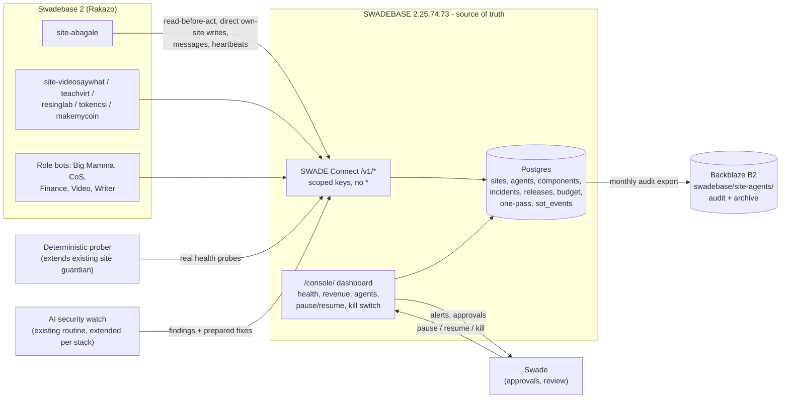

# SWADE Site Agents: Source of Truth, Spec v1

**Status: Spec v1, 2026-10-24, not built.** This is a spec only. No tables, routes, keys, services, deploys or restarts have been created or changed. All SQL in Appendix A is **NOT APPLIED**. Marks such as *(unverified)* show what was not checked.
**Author:** Big Mamma (Grok Bot), for Swade's review. **Supersedes:** design draft v0.1 (`SWADE_SITE_AGENTS_SOURCE_OF_TRUTH.md`, same date).
**Decisions:** every "decided" item below is in [DECISIONS.md](DECISIONS.md) (D-01 … D-21). Open items are listed there with recommendations.
**Canonical copy:** SWADEBASE `/opt/swadebase/docs/site-agents/`. Hub mirror: `docs/site-agents/`. Dated archives: B2 `swadebase/site-agents/archive/<YYYY-MM-DD>/`.
**No secret values appear in this spec.** Credentials are referred to by name only.

## Table of contents

0. [Summary and what changed](#0-summary-and-what-changed)
1. [Scope: money sites and agents](#1-scope-money-sites-and-agents)
2. [Ownership, the site override, and shared components](#2-ownership-the-site-override-and-shared-components)
3. [What lives in the source of truth (SWADEBASE)](#3-what-lives-in-the-source-of-truth-swadebase)
4. [Writes and versioning: newer writes win](#4-writes-and-versioning-newer-writes-win)
5. [How agents check in, act and message each other](#5-how-agents-check-in-act-and-message-each-other)
6. [Self-heal first, criticalness score, alerts and pause](#6-self-heal-first-criticalness-score-alerts-and-pause)
7. [Approval levels and customer-facing rules](#7-approval-levels-and-customer-facing-rules)
8. [Shared budget pool, kill switch, pause and resume](#8-shared-budget-pool-kill-switch-pause-and-resume)
9. [Revenue and costs per site](#9-revenue-and-costs-per-site)
10. [Open-source replacement research](#10-open-source-replacement-research)
11. [Security scouting](#11-security-scouting)
12. [Staging and release tracking](#12-staging-and-release-tracking)
13. [Dashboard (expanding swadebase.cloud /console/)](#13-dashboard-expanding-swadebasecloud-console)
14. [Audit trail and B2 archive](#14-audit-trail-and-b2-archive)
15. [Runbooks, intake and one-pass](#15-runbooks-intake-and-one-pass)
16. [Rollout](#16-rollout)
17. [Review checklist for Swade](#17-review-checklist-for-swade)
- [Appendix A: Proposed SQL (NOT APPLIED)](#appendix-a-proposed-sql-not-applied)
- [Appendix B: Proposed SWADE Connect routes and scopes](#appendix-b-proposed-swade-connect-routes-and-scopes)
- [Appendix C: Evidence snapshot (2026-10-24)](#appendix-c-evidence-snapshot-2026-10-24)

---

## 0. Summary and what changed

There is **one agent per money-making site**. Each site agent owns its site's uptime, client questions and day-to-day operations. It also runs **standing research** into open-source replacements for the site's paid services, aiming for zero cost.
**SWADEBASE is the source of truth for everything.** Agents read and write it only through SWADE Connect, using per-agent scoped keys. On SWADEBASE:
- each site agent writes **directly** to its own site's records;
- **newer writes win**, nothing goes back in time, and full history is kept;
- the site agent has **override** on conflicts about its own site.

Agents **self-heal first and tell Swade afterwards**. They score every incident on **one shared criticalness rubric** and recommend pausing a site when the score says so. Every agent draws from **one shared budget pool**. That pool, plus per-agent pause and resume and a **global kill switch**, is controlled from the **existing swadebase.cloud `/console/` dashboard**. Every action and every agent-to-agent message lands in an **audit trail**, which is archived to Backblaze B2 under the SWADEBASE folder.

### Design in one picture



### What v1 changes from v0.1 and from the multi-bot doc

| Topic | v0.1 draft | **v1 (decided)** | Multi-bot doc section affected |
|---|---|---|---|
| Money sites | abagale, videosaywhat, teachvirt, resinglab, tokencsi; makemycoin and maestroradio "to confirm" | abagale, videosaywhat, teachvirt, resinglab, tokencsi, **makemycoin**. **maestroradio is not a money site** (D-01, D-21) | §6.6 (Option C threshold is overridden for money sites) |
| Own-site record writes | Optimistic `If-Match`. A second conflict becomes a `change_proposal` | **Direct writes, no proposal step** (D-05) | §4.1 gates (own-site records are not gated) |
| Conflicts | Owner decides; proposal path | **The site agent has override on its own site.** Shared components keep a single owner, who must accommodate (D-02, §2) | §3.4, §4.1 |
| Versioning | `409` on stale `If-Match` | **Newer writes win**, server-monotonic, stale writes kept as history only (D-04, §4) | Appendix A (versions) |
| Self-fix | L1 only after approval of an allowlist; "must ask" cases | **Self-heal first, ping Swade after**, inside the self-heal envelope (D-06, §6.1) | §4.1 |
| Severity | SEV1–4 by description | SEV1–4 **derived from a 0–100 criticalness score**, plus a pause threshold (D-10, §6.2) | §4.7 incidents |
| Budget | Per-bot estimate | **One shared pool**, per-agent usage tracking, kill switch cuts it (D-07, §8) | §4.6 budgets, §6.4 cost |
| Audit retention | `swade_request_logs` + handoffs; multi-bot proposed 90 days for convlog | **Keep as long as storage allows**, then archive to B2 `swadebase/site-agents/audit/` (D-13, §14) | §3.8 / multi-bot D11 (90-day retention) |
| Agent messaging | Handoffs only | **Direct agent-to-agent messages through SWADEBASE**, all logged (D-19, §5.4) | §3.3 handoffs, Appendix A convlog |
| Dashboard | Not covered | **Expand `/console/`**: health, revenue, agent status, pause/resume, kill switch (D-16, §13) | — |
| Staging, releases, security, OSS research, one-pass, intake | Not covered (release drift only noted) | Specified (§10–§15, one-pass.md) | — |
| Hop limit | 3 for proposals vs 5 general | Still 5 for handoffs. Own-site writes need no hops. Shared-component requests use site → owner → Swade (≤ 3) | §3.5 (unchanged) |

---

## 1. Scope: money sites and agents

### 1.1 Money sites (decided: D-01, D-21)

| Order | Site (slug) | Domain (registry) | Data location | Notes |
|---|---|---|---|---|
| 1 | **abagale** ("Abigail") | abagale.live | SWADEBASE schema `abagale` (604 tables) | First case. See [runbooks/abagale.md](runbooks/abagale.md) |
| 2 | videosaywhat | videosaywhat.com *(registry)* | SWADEBASE schema `videosaywhat` | `vsw-*` functions |
| 3 | teachvirt | registry says `teachvert.courses` *(domain mismatch, to fix)* | SWADEBASE schema `teachvirt` | Nightly credit-grant cron on SWADEBASE |
| 4 | resinglab | resinglab *(registry)* | SWADEBASE schema `resinglab` | Rule 7: never downgrade the scroll |
| 5 | tokencsi | tokencsi.com | SWADEBASE schema `tokencsi` | |
| 6 | **makemycoin** | registry `https://makemycoin.live/` (answers 200, Next.js behind Cloudflare). The site guardian's directory lists `makemycoin.cash`, which has no DNS answer and fails TLS, so the guardian shows it red | **Separate, older database, not SWADEBASE's main schema.** There is no `makemycoin` schema on SWADEBASE. Registry platform: "Lovable". Exact DB host *(unverified)* | **Prerequisite: bring its data into SWADEBASE first** (§16.2) |

**Not money sites:** maestroradio (Maestro Radio) and every other site. They stay with the role bots (multi-bot Option B/C). The `maestroradio_stage` schema is unaffected.

### 1.2 Agents

| Agent id | Kind | Owns |
|---|---|---|
| `site-<slug>` (one per money site) | site | The site's uptime, client questions, day-to-day ops, OSS replacement research, security scouting follow-up for its stack, its runbook, its staging, its release record |
| `big-mamma` | platform | Sets up and verifies every bot (standing rule). Owns shared infrastructure components (§2.3). Breaks leases. Verifies SEV1/2 closures |
| `cos` | role | Daily summary, morning brief, cross-site coordination, email sending policy |
| `finance` | role | Stripe (`stripe-platform`), the per-site revenue and cost feed (§9), budget pool accounting (§8) |
| `video`, `writer`, … | role | As in the multi-bot doc |
| `prober` | prober | Non-LLM real health probes (§5.2) |

**Replacement rule (standing):** a replacement AI for any agent gets the same knowledge and capabilities. Everything an agent knows lives in SWADEBASE (its `agents` row, its policy, runbook, `site_knowledge`, `sot_events` history), never only in a bot's private memory. Big Mamma sets up and verifies the replacement through the same `draft → testing → ready` path.

---

## 2. Ownership, the site override, and shared components

### 2.1 The rule (decided: D-02, D-03)

1. **SWADEBASE is the source of truth** for every site and agent fact. If a bot's memory, a doc or a dashboard disagrees with SWADEBASE, SWADEBASE wins.
2. **The site agent has override on conflicts about its own site.** When another agent's write or plan conflicts with the site agent's write about that site, the site agent's position stands and the other agent adapts.
3. **Shared components keep exactly one owner** (Stripe, auth, B2, the gateway, the edge runtime, DB, nginx, DNS, email, secrets, autoheal).

### 2.2 How the override coexists with single owners (recommended; open nuance for Swade, O-01)

| What the conflict is about | Who wins | How |
|---|---|---|
| The site's **own config and data**: its `ecosystem_sites` row, its schema's operational rows, its incidents, runbook, FAQ, intake flavour, staging, its share of one-pass links, its release record, its site-scoped settings inside a shared component (for example its own webhook endpoint row or its own storage bucket policy) | **Site agent override.** Its write applies immediately; another agent's conflicting write on the same field is held as history (§4.3). The other agent must re-read and adapt | Direct write. The override is recorded in `sot_events` (`kind = override`) |
| A change to the **shared component itself** that would affect other sites (Stripe account settings, shared `STRIPE_SECRET_KEY`, GoTrue config, the edge container, nginx global config, B2 key, DNS zones) | **The component owner executes**, but **must accommodate** the site's need | The site agent sends a `component_request` message (§5.4). The owner must answer within the SLA (SEV1: 15 min, SEV2: 2 h, else 1 business day) with **done**, **done differently** (same outcome, safer method), or **cannot without harming other sites**. "Cannot" needs evidence and goes straight to Swade with both positions. The owner may not simply refuse |
| Two site agents need opposite things from one shared component | Neither override applies (each override covers only its own site) | The owner proposes a solution that serves both. If none exists, Swade decides |
| Swade-gated actions (deploys, sends, money, deletes, DNS, keys) | Neither: **Swade** | Override never bypasses an approval gate (§7) |

### 2.3 Shared-component registry (initial rows, proposed)

| `slug` | What | Owner | Money sites that depend on it | Risk |
|---|---|---|---|---|
| `stripe-platform` | One shared merchant: **Swadez**, `acct_1SizGm43OPTHaIwn` (live identity verified; owner reaffirmed 2026-11-07). Default for future Stripe builds and billing setups. Protected shared `STRIPE_SECRET_KEY`; per-site webhook secrets and fulfillment (names only) | **Finance** | abagale, videosaywhat, teachvirt, resinglab, tokencsi (`billing` module); makemycoin *(billing source unverified)* | One shared secret: any change hits every site |
| `swadebase-auth` | GoTrue, shared `auth.users`, Google OAuth | Big Mamma | all | |
| `onepass` | One-pass identity (`public.onepass_*`) and the one-pass client record (one-pass.md) | Big Mamma (identity), with **every site agent as a writer** of client records | all | PII |
| `b2-media` | Backblaze B2 bucket and keys (`/opt/swade-secrets/b2.env`, `BACKBLAZE_*`), mirrored under `swadebase/` | Big Mamma | all with storage | One shared key |
| `swade-connect` | Gateway `/v1/*`, keys, request logs | Big Mamma | all | Webhook signing not built |
| `edge-runtime` | `supabase-edge-functions` (all `abg-*`, `vsw-*`, …) | Big Mamma | all | One restart hits every site |
| `kong`, `swadebase-db` | Gateway and Postgres | Big Mamma | all | |
| `web-nginx` | Host nginx on SWADEBASE serving static releases | Big Mamma | abagale (confirmed), others *(unverified)* | |
| `email-transactional` | Resend, SMTP, mailcow, `email_send_log`, `suppressed_emails` | CoS (policy) / Big Mamma (infra) | sites that send mail | No sends without approval |
| `dns-cloudflare` | Cloudflare zones | Big Mamma, every change gated by Swade | all public domains | |
| `secrets-locker` | `/opt/swade-secrets/*.env`, `functions.env` | Big Mamma | all | Names only |
| `autoheal` | `swadebase-autoheal` timer + `/console/` repair routes | Big Mamma | all | The only sanctioned restart path |
| `hostinger-platform` | Hostinger account (hPanel, managed PHP hosting, webmail, VPS) | Big Mamma | all (account level) | PHP backend: in scope for security scouting (§11) |
| `coolify-sb2` | Coolify on Swadebase 2 (PHP/Laravel) | Big Mamma | agent host | Security watch flagged PHP2Shell on it (Oct 22) |

### 2.4 Ownership matrix for `site-<slug>`

| Area | Writes directly (no proposal) | Needs another owner or Swade |
|---|---|---|
| Own site row, health, status notes, runbook, FAQ drafts, intake flavour | ✅ | Marking a FAQ fact `verified` (Swade or CoS) |
| Own incidents (open, update, score, close with verification) | ✅ | SEV1/2 closure is verified by Big Mamma |
| Own schema operational data (job retries, live-source marking, ticket triage, tags) | ✅ | `DELETE`, schema or RLS change, roles, entitlements, credits, refunds → Swade |
| One-pass client records it touches | ✅ (newer wins, §4) | Merging two clients → Big Mamma verifies (one-pass.md §5) |
| Self-heal actions in its envelope (§6.1) | ✅, then ping | Anything outside the envelope |
| Staging environment (§12) | ✅ deploy to its own staging *(open, O-04)* | Production deploys → Swade |
| Release record (§12) | ✅ writes what is live | — |
| OSS comparisons, security findings, prepared fixes | ✅ writes and prepares | Switching services or applying a fix → Swade (per approval level) |
| Shared components | Read, open an incident, `component_request` | The owner executes |
| Other sites | Read status, and one-pass records linked to its own site | — |
| Customer-facing sends | Draft only | Swade or a standing grant |
| Keys | — | Access-request queue → Swade |

---

## 3. What lives in the source of truth (SWADEBASE)

Machine truth lives in **SWADEBASE (2.25.74.73) Postgres**. It is reached only through SWADE Connect with per-agent keys; agents never hold DB credentials. This follows the single-locker rule: no Supabase cloud, no Lovable backends.

### 3.1 Content map

| # | Content | Stored in | Writers |
|---|---|---|---|
| 1 | Site inventory (domains, hosting, web root, repo, schema, money flag, site agent, staging URL) | `swadesoul.ecosystem_sites` (existing, extended) | Site agent (own row), Big Mamma |
| 2 | Live health | `ecosystem_sites.last_health_*` + `ecosystem_health_checks` via existing `POST /v1/registry/:slug/health` | Prober, site agent |
| 3 | Agents, status, policy, pause state, heartbeats | `swadesoul.agents` (**new**) | Big Mamma (setup); each agent its own heartbeat; dashboard (pause) |
| 4 | Shared components and owners | `swadesoul.shared_components` (**new**) | Owner |
| 5 | Dependencies | `swade_site_modules` × `swade_modules.component_slugs` (new column) | Big Mamma |
| 6 | Runbooks, playbooks, FAQ, OSS comparisons | `swadesoul.site_knowledge` (existing, add `site_slug`, kinds) | Site agent |
| 7 | Incidents with criticalness score | `incident_guardian.incidents` (existing, extended) | Site agent / component owner |
| 8 | Releases (what is live, per environment) | `swadesoul.site_releases` (**new**) | Site agent, deploy tooling |
| 9 | Security findings and prepared fixes | `swadesoul.security_findings` (**new**) | Security watch, site agent |
| 10 | Budget pool and per-agent usage | `swadesoul.budget_pool`, `swadesoul.agent_usage` (**new**) | Finance (pool), gateway (usage) |
| 11 | Global control (kill switch, resume mode) | `swadesoul.agent_control` (**new**, one row) | Swade via dashboard only |
| 12 | Revenue and costs per site (read-only to site agents) | `swadesoul.site_finance_daily` (**new**) | Finance only |
| 13 | One-pass client records, site links, client events and intakes | `public.onepass_client_records`, `public.onepass_client_site_links`, `public.onepass_client_events` (**new**, beside the existing `public.onepass_*`) | Every agent (newer wins) |
| 14 | Handoffs and agent messages | `swadesoul.agent_handoffs`, `swadesoul.agent_conversation_log` (multi-bot Appendix A, amended) | Per sender |
| 15 | Leases (who is acting on what right now) | `swadesoul.agent_leases` (**new**) | Holder |
| 16 | **Audit trail and full write history** | `swadesoul.sot_events` (**new**, append-only, hash-chained) + existing `swade_request_logs`, `ecosystem_registry_audit` | Gateway (automatic) |

### 3.2 Why each new table exists

| New table | Why nothing existing fits |
|---|---|
| `agents` | There is no bot registry. `swade_api_keys.owner_kind` names a key's owner, not a bot's lifecycle, heartbeat, policy or pause state |
| `shared_components` | `swade_modules` are product capabilities, not infrastructure instances. `op_ecosystem_services` (0 rows) is a priced catalogue |
| `agent_leases` | Atomic "I am acting on this now" with expiry and fencing, so two agents do not restart or roll back the same thing at once. Newer-wins (§4) settles **data**; leases settle **actions** |
| `sot_events` | One append-only stream for audit, full record history (each version's after-image), stale writes, overrides, messages, controls and self-heals. `ecosystem_registry_audit` covers one table only. `swade_request_logs` has no after-images |
| `site_releases` | Nothing records which commit or release is live. abagale's live build is not on GitHub |
| `security_findings` | Findings are pre-incident (a CVE may never become an incident) and need a prepared-fix state |
| `budget_pool`, `agent_usage` | There is no shared spend ledger across bots and services. Per-site `ai_usage_logs` tables exist (abagale, teachvirt, tokencsi, sonikyn) but track app users, not agents |
| `agent_control` | Single row for the global kill switch and resume mode, read by the gateway on every agent call |
| `site_finance_daily` | Revenue lives in many per-site tables (`abagale.revenue_events`, `swadesoul.revenue_events` 1 row, …) and in Stripe. Finance needs one normalised, read-only feed per site |
| `onepass_client_*` | Existing `public.onepass_identities` (259 rows) and `onepass_memberships` (128) cover sign-in identity and entitlements, not a client relationship across sites (intakes, tickets, notes, prospects without an account). See one-pass.md |

The total is 12 new tables (plus the 2 already proposed in the multi-bot doc) and new columns on 4 existing tables. There is no new schema.

---

## 4. Writes and versioning: newer writes win

**Decided (D-04, D-05):** newer writes win and nothing goes back in time. Versions and timestamps are monotonic, a stale write is never applied over a newer one, and full history is kept. Agents write directly to their own site's records.

### 4.1 Mechanics

1. Every mutable SoT row carries `version bigint` and `as_of timestamptz`.
2. Every write through SWADE Connect carries `as_of`: the time the agent observed the facts it is writing. If it is missing, the server time is used.
3. The gateway runs, in one transaction:
   - Take a **global monotonic sequence number** `seq` from `swadesoul.sot_seq`, which is never reused.
   - **Newer check:** the write applies only if its `as_of` is **≥** the row's current `as_of`. On an equal `as_of`, the higher `seq` wins.
   - **If applied:** set `version = version + 1`, `as_of = max(old, new)`, and `updated_at = now()` (server clock, which is monotonic per row because it is clamped: `greatest(now(), old.updated_at + 1µs)`). Append the after-image to `sot_events` with `outcome = applied`.
   - **If older:** do not touch the row. Append it to `sot_events` with `outcome = stale_history` and return `200 {applied:false, reason:"stale", current_version, current_as_of}`. Nothing is lost and nothing goes back in time.
4. **Field-level merge:** writes are field patches, not whole-row replacements. Two agents writing different fields both apply. "Newer wins" is judged per field (`field_as_of` jsonb on the row), so a fresh status note does not get wiped by an older patch to a different field.
5. **Override (§2.2) layered on top:** for the site's own config and data, a write from the site agent sets `override_until = now() + 24h` on those fields. A write by another agent to an overridden field during that window is stored as `stale_history` with `reason = site_override`, and that agent receives a `site_override` message. The site agent can clear the override early. Swade and Big Mamma writes always apply.
6. **No rewinds:** "restore an older value" is done as a **new** write that copies the old value, with a new `seq` and `as_of = now()`. History is never edited.
7. **Clock safety:** the server rejects `as_of` more than 2 minutes in the future (`400 clock_skew`). Agents' clocks come from the box NTP.

### 4.2 What counts as a record

The following count as records: the site row, agent row (own heartbeat or status), incident, runbook and knowledge entries, release record, finance row (Finance only), security finding, one-pass client record or link or event, and shared component (owner only).

Leases and approvals are **not** versioned records. They are state machines with their own rules (§5.3, §7).

### 4.3 History

`sot_events` holds every applied and stale write with its full after-image (secrets are never written; the gateway rejects payloads matching secret patterns). This makes the following cheap and exact:
- "show me abagale's record as of Oct 20"
- "who changed this"
- "what did the other agent try to write"

Retention and archiving are covered in §14.

---

## 5. How agents check in, act and message each other

### 5.1 Read-before-act (mandatory)

Before acting, an agent calls `GET /v1/sot/sites/:slug`. It returns:
- the site row (version and `as_of`)
- dependencies and component status
- open incidents with scores
- active leases
- unread messages
- the live and staging release
- open security findings
- budget remaining
- control state (paused or killed)

The agent must:
1. **Stop if it is paused or the kill switch is on** (the gateway also enforces this).
2. Link to an existing incident on a shared component rather than opening a duplicate (dedupe on `recurrence_key`).
3. Take a lease before any **action** (restart, retry batch, rollback, staging deploy).

### 5.2 Heartbeats and real health

- **The prober extends what already exists.** SWADEBASE already runs a non-LLM site guardian that probes 55 sites and writes `/opt/sssbrain-ops/guardian-status.json`; the last run was 2026-10-24 07:24 UTC (2:24 AM CT): 2 green, 34 yellow, 19 red. It is fooled in the same way as the registry: abagale shows homepage 200 and health 200 because the SPA answers every path. It also probes the wrong MakeMyCoin domain.
  - v1 extends this prober (no new app) with a per-site `health_probe` definition from `ecosystem_sites.health_probe`.
  - It writes results via `POST /v1/registry/:slug/health` with a prober-only key.
  - Agents wake on a state change, plus 2 scheduled runs a day. Where the prober runs is open (O-06).
- **Heartbeat:** `POST /v1/agents/:id/heartbeat {run_id, ok, seconds, tokens, cost_usd}` after each run. It updates `agents` and `agent_usage`. A missed heartbeat (2× the interval) appears on the dashboard and in CoS's brief.

### 5.3 Leases

Leases are carried over from v0.1:
- `POST /v1/leases {resource_type, resource_key, ttl_s ≤ 900}` → `{lease_id, fencing_token}`, or `409` with the current holder.
- Actions carry `X-Swade-Lease`. An older fencing token is rejected.
- Big Mamma can break any lease, and doing so is logged.
- **A site agent wins a lease contest on its own site's resources (override).** The holder gets a `lease_preempted` message.

### 5.4 Agent-to-agent messages through SWADEBASE (decided: D-19)

- `POST /v1/messages {to, thread_id?, kind, body, refs[]}`.
  - `kind` ∈ `note | question | answer | component_request | component_reply | site_override | incident_update | approval_request | oss_comparison | security_finding`.
  - `to` is an agent id, `site:<slug>` (that site's agent), `component:<slug>` (that component's owner), or `all`.
- **Every message is logged in full** in `agent_conversation_log`: from, to, thread, kind, body, refs, `seq`. It is also mirrored as an `sot_events` row (`kind = message`).
  - This changes the multi-bot proposal, which truncated and kept logs for 90 days. In v1, logs are kept as long as storage allows, then archived (§14).
- `GET /v1/messages?unread=1` is part of read-before-act.
- Messages that need work become `agent_handoffs` (task, approval_request), as in the multi-bot doc.
- **Hop limit stays 5** for handoff chains. A `component_request` must resolve within site → owner → Swade (≤ 3 hops).
- **No PII in message bodies beyond what is needed.** Refer to one-pass `client_id` and ticket ids, not emails.
- **No silos (standing rule):** any agent can read any message thread that references a site or component it depends on. Only threads tagged `pii` are restricted to the participants plus Big Mamma.

### 5.5 Daily summaries

CoS's daily summary gains a **Sites** block. For each money site:
- health (real probe), uptime %
- incidents opened and closed, with the highest criticalness score
- self-heals done
- pending approvals
- spend versus the pool
- revenue yesterday (Finance feed)
- new security findings and OSS comparisons

---
## 6. Self-heal first, criticalness score, alerts and pause

### 6.1 Self-heal first, ping Swade after (decided: D-06)

The site agent fixes what it safely can **immediately**, then tells Swade what happened. The **self-heal envelope** covers only actions that are reversible, limited to its own site, and not behind a standing approval gate:

| Self-heal (do now, ping after) | Limits |
|---|---|
| Retry idempotent failed jobs in its own schema | 3 attempts per job |
| Mark live sources degraded or dead using the app's existing strike logic | As coded in the app |
| Re-run its own health and validation functions | — |
| Ask autoheal to restart a service **on its site's allowlist** | Autoheal's 1 per service per 30 min, plus max 3 per site per 24 h. Shared containers (edge-functions, kong, db, auth, nginx) are never self-heal for a site agent |
| Clear its own stuck queues or locks in its schema (no row deletes; set status only) | — |
| Switch its own site's feature flags to a safe "degraded" mode, if the site has such flags | Only flags marked `safe_degrade` in its runbook |
| Roll the web release back to the **previous known-good** release | **Open: O-03.** Recommended as self-heal, because it is instant, reversible and returns to a release Swade already approved. Until Swade decides, it is a Swade-gated deploy |

After every self-heal:
1. Write an `sot_events` row (`kind = self_heal`, before/after, lease, result).
2. Update or open the incident.
3. **Ping Swade** using the alert format in §6.3.

Self-healing **stops and asks** when:
- the same symptom returns within 24 h of a self-heal;
- the fix would touch another site or a shared component;
- user data could be lost;
- the score reaches the pause threshold (§6.2).

### 6.2 Criticalness score (decided: D-10). One rubric for every agent

**Score = U + R + S + D + P, from 0 to 100.**

| Factor | Points | Scale |
|---|---|---|
| **U: User impact** | 0–30 | 0 none · 5 cosmetic · 10 one minor feature or a few users · 20 a core flow broken for some users (login, playback, upload, checkout) · 30 site down or a core flow broken for all users |
| **R: Revenue impact** | 0–25 | 0 none · 5 a non-revenue page · 10 a revenue feature degraded (slow checkout, one plan) · 18 payments failing intermittently or webhooks not landing · 25 no payments possible, or wrong charges/credits being issued |
| **S: Security** | 0–20 | 0 none · 5 hardening gap (for example a `*` key, no CSP) · 10 known vulnerability in the stack, not known to be exploited · 15 actively exploited in the wild (CISA KEV, vendor) and present in the stack · 20 evidence of compromise or an exposed secret |
| **D: Data risk** | 0–15 | 0 none · 5 stale or inconsistent data, recoverable · 10 data loss or corruption possible, backups OK · 15 ongoing loss/corruption or personal data exposed |
| **P: Spread** | 0–10 | 0 one feature on one site · 4 the whole site · 7 a shared component (several sites) · 10 the platform (SWADEBASE, auth, gateway, all sites) |

Scoring rules:
- The scorer gives each factor with a one-line reason and stores it in `incidents.payload.score`.
- The agent re-scores on every update.
- When uncertain, take the higher band and mark it `unverified`.
- Component incidents are scored by the component owner. Site agents may add a site-specific U and R note.

**Thresholds:**

| Score | SEV | Response | Who is told |
|---|---|---|---|
| **≥ 70** | **SEV1** | Self-heal within 5 min, then **ping Swade immediately** | Swade, Big Mamma, CoS, owner |
| 50–69 | SEV2 | Self-heal within 30 min, then ping Swade | Swade (ping), Big Mamma, CoS |
| 25–49 | SEV3 | Same day | Daily summary, CoS brief |
| < 25 | SEV4 | Next routine run | Daily summary |

**Pause recommendation.** The agent **recommends pausing the site** (it never pauses the site itself) when **any** of these is true:
1. the score is **≥ 85**;
2. **S ≥ 15** (actively exploited or compromised), even if the total is lower;
3. **D = 15** (ongoing data loss or personal data exposure);
4. **R = 25** because wrong charges or credits are being issued (pausing stops further damage);
5. a SEV1 has not improved after 2 self-heal attempts and 60 min.

Pausing a site means maintenance mode, checkout disabled, or similar per the runbook. It is a production change, so **Swade approves it**. The recommendation includes what pausing would do, what it costs (revenue per hour from §9) and how to resume. Whether to allow an automatic pause for S = 20 (confirmed compromise) is open (O-02).

### 6.3 Alert format (per incident)

```
[SEV2 · score 58 · abagale] Video uploads failing on iPad Safari (U20 R10 S0 D10 P4)
Self-healed: retried 4 jobs (2 ok) · restarted nothing · lease site:abagale
Now: degraded · next step: fix prepared on staging (release stg-…), needs your approval to deploy
Pause recommended: no · Incident INC-20261024-ABAGALE-UPLOAD · dashboard: swadebase.cloud/console/#site-abagale
```

**Delivery:** SEV1 and SEV2 alerts go to Swade through the channel he picks (O-05). They are internal pings to Swade, not customer-facing messages. SEV3 and SEV4 go into the daily summary.

---

## 7. Approval levels and customer-facing rules

| Level | What | Gate |
|---|---|---|
| **A0 Direct** | Read, probe, write its own site's records, open, score and update incidents, message agents, draft replies, OSS comparisons, security findings, prepare fixes on a branch or PR (not merged) | None (decided: D-05) |
| **A1 Self-heal** | The §6.1 envelope | None, ping after (D-06) |
| **A2 Owner** | Anything changing a shared component | The component owner executes (§2.2) |
| **A3 Swade** | Production deploys (including releases with security fixes), customer-facing sends, money (refunds, plan or credit changes, service switches that cost or save money), deletes, DNS, keys, pausing a site, switching to an OSS replacement, merging code | Swade every time, or a recorded `standing_grant` |

The standing rules that still apply:
- **Customer-facing sends stay drafts** unless Swade grants a standing permission. Each standing permission names the site, channel, template and expiry.
- **Deploys need approval.**
- **Never show secrets.**
- **Big Mamma sets up and verifies every bot.**

Customer-reply rules are carried over from v0.1 unchanged:
- draft only;
- use only verified facts;
- no promises of refunds, dates or features;
- billing questions go to Finance;
- account and security questions go to Swade;
- use ticket ids and `client_id`s, not emails, in logs.

---

## 8. Shared budget pool, kill switch, pause and resume

### 8.1 One shared pool (decided: D-07)

- **One pool per calendar month** (`budget_pool`). It covers AI/tokens (Rakazo, OpenRouter or model providers) and agent-initiated service spend (paid APIs the agents call themselves).
- Swade sets the amount (O-07). Finance keeps the books. Per-site product costs paid by the sites themselves (for example Mux for abagale's users) are **not** in the pool; they show in §9.
- **Per-agent usage tracking:** every agent run and paid call posts to `agent_usage`: agent, site, provider, units, cost_usd, run_id, `seq`. The gateway records it on heartbeat. Rakazo usage data is reconciled nightly by Finance *(Rakazo usage API unverified)*.
- **Soft guardrails, not separate budgets:**
  - At 50% of the pool, a dashboard notice.
  - At 80%, Swade is pinged, and agents drop to the cheapest tier for scheduled runs. Incident runs are unchanged.
  - **At 100%, the pool is exhausted.** Agents keep L0 reads and the prober only (no paid calls), and Swade is pinged to top up.
  - If one agent passes 40% of the pool, it is flagged as an outlier in the daily summary. This is not blocked.

### 8.2 Pause and resume per agent (dashboard)

- **Pause** sets `agents.status = 'paused'` and `paused_by`, `paused_reason`. The gateway then refuses that agent's writes and paid calls (`423 agent_paused`). It still accepts heartbeats, and messages addressed to it queue.
- Big Mamma also disables the agent's Rakazo routines *(Rakazo routine control API unverified; until confirmed, the gateway refusal is the enforcement)*.
- **Resume** clears the pause. A resumed agent must do read-before-act first.

### 8.3 Global kill switch (decided: D-16)

One action on the dashboard, with a typed confirmation:
1. Sets `agent_control.killed = true`. The gateway refuses **every** agent write and paid call (`423 kill_switch`). Only the prober and heartbeats stay on.
2. **Cuts the budget pool:** sets `budget_pool.state = 'frozen'` and available = 0. Big Mamma also sets provider-side spend limits to 0 where an API exists *(OpenRouter and Rakazo limit APIs unverified; to confirm in Phase 0)*.
3. Releases all agent leases and writes an `sot_events` `kind = control` row.
4. Pings Swade with the confirmation and the list of agents stopped.

**Resume options** (Swade picks at kill time, and can change before resuming), stored in `agent_control.resume_mode`:
- **`automatic`:** on "Resume all", the pool is unfrozen and every agent returns to its previous status.
- **`review_each`:** on "Resume all", the pool is unfrozen but every agent stays `paused` until Swade clicks **Review and resume** on that agent. The card shows its last actions, open incidents and pending messages.

---

## 9. Revenue and costs per site

**Decided (D-09):** each site agent can see its own site's revenue and costs, read-only. **Finance still owns Stripe.**

- Finance writes `site_finance_daily` (site, date, gross, refunds, fees, net, currency, new and cancelled subscriptions, ai_cost, service_cost, source, `as_of`).
- Sources:
  - Stripe, attributed per site by webhook endpoint or metadata. Finance holds the key; agents never do.
  - Per-site revenue tables (`abagale.revenue_events`, `swadesoul.revenue_events`, …).
  - Service invoices.
  - `agent_usage`.
- A site agent's key gets `finance:read:own-site` only: no Stripe key, no other sites' numbers, no customer-level payment data (aggregates only).
- The agent uses it to judge **R** in the criticalness score (revenue per hour at risk) and to rank OSS swaps by savings.
- The dashboard shows revenue, cost and net for 7 and 30 days per site.
- MakeMyCoin's revenue source is *unverified* until its data move (§16.2).

---
## 10. Open-source replacement research

**Decided (D-01, D-08):** every site agent keeps a **standing** list of the paid services its site uses and researches open-source or self-hosted replacements, aiming for zero cost. Findings reach Swade as a **comparison first**. **Nothing is switched without Swade's approval.**

- **Inventory:** `site_knowledge` kind `paid_service`, with one row per service: provider, what the site uses it for, monthly cost (from the §9 feed or the invoice), where it is configured (env names only), and the shared component it belongs to, if any.
  - abagale's starting list: Mux, ElevenLabs, Replicate, Twilio, Restream, Printify, Suno, Stripe (payments; there is no OSS replacement for card processing, so its fees are tracked but it is not a swap target), B2 and Resend *(costs unverified)*.
- **Cadence:** each scheduled run takes one service, rotating through the list.
  - Re-check sooner on a price change, an outage or a new OSS release.
  - Prefer things already self-hosted in the ecosystem, such as the existing voice and STT services and the GPU controller *(fit unverified per service)*.
- **Comparison format** (`site_knowledge` kind `oss_comparison`, plus an `approval_request` handoff to Swade):

| Field | Content |
|---|---|
| Service now | Provider, plan, monthly cost (30-day actual) |
| Candidate(s) | Project, license, maturity (stars, release cadence, last release), hosting needs (CPU/GPU/RAM) |
| Cost | Hosting and ops cost on SWADEBASE, Swadebase 2 or GPU vs current; break-even |
| Features | Parity table; gaps that users would notice |
| Risk | Security record, maintenance burden, lock-in, quality (for example voice quality), legal or licensing |
| Migration effort | Steps, hours, data migration, staging test plan (§12), rollback |
| Recommendation | Switch, pilot on staging, or wait, with confidence and *unverified* marks |

- Pilots run on the site's **staging** only after Swade approves the pilot. A production switch is a separate approval.

---

## 11. Security scouting

**Decided (D-11):** security scouting runs per stack. It looks for new CVEs and zero-days, **prepares a fix immediately**, and applies it according to the approval levels. It covers PHP and Hostinger as well (Hostinger's backend is PHP), and it is tied into the existing AI security watch routine.

- **The existing routine:** Big Mamma's *AI security watch* already runs about every 3 hours. It checks:
  - reviewed and unreviewed GitHub advisories
  - npm and PyPI malware feeds
  - CISA KEV
  - vendor news, searched against swadesoul code

  Each run is journalled. Example: on Oct 22 it escalated Coolify PHP2Shell (CVE-2026-109618/109619) on Swadebase 2. v1 **extends it, it does not replace it.**
- **Per-stack inventory** (`site_knowledge` kind `stack`, per site, refreshed weekly by the site agent):
  - frameworks and lockfile packages (Vite/React, Next.js for makemycoin)
  - Deno edge functions and imports
  - Postgres, GoTrue, Kong and Supabase image versions
  - nginx and OpenSSL on SWADEBASE
  - Python services
  - Coolify (PHP/Laravel) on Swadebase 2
  - **Hostinger account-level PHP surface**: hPanel-managed PHP hosting, any WordPress installs (via the Hostinger connector), Roundcube webmail
  - Cloudflare features in use
- **Flow:**
  1. The watch matches a new advisory to the stack inventory.
  2. It writes a `security_findings` row (CVE/GHSA, component, sites, exploited-in-the-wild flag, the criticalness **S** factor and total, evidence) and messages the affected site agents and the component owner.
  3. **A fix is prepared immediately:**
     - a version bump or patch on a branch with a PR (**not merged**) and a staging build, or
     - a config change written up as exact steps, or
     - a mitigation such as a WAF rule proposal.
     
     Prepared fix status: `prepared`.
  4. **Apply according to approval levels:**
     - production deploys, key rotation and DNS/WAF changes are Swade-gated (A3);
     - for SEV1 security items (score ≥ 70 or S ≥ 15), the ping asks Swade for **expedited approval** and includes the pause recommendation if §6.2 applies;
     - turning on an already-built safe-degrade flag is self-heal (A1).
  5. Verify, close and add a regression check to the runbook.
- **Known items to seed:**
  - `*`-scoped SWADE Connect keys (abagale ×2, attobahn, ssworld): S = 5 hardening.
  - Coolify panel publicly reachable on Swadebase 2: from the security watch log; status of the update *(unverified)*.

---

## 12. Staging and release tracking

### 12.1 Per-site staging (decided: D-14)

| Piece | Staging per site | Precedent |
|---|---|---|
| Web | `/var/www/<slug>-app/staging/` served at **`swadebase.cloud/stage/<slug>/`** (no DNS change needed). A `staging.<domain>` hostname is optional later (DNS = Swade) | Release-folder pattern of `/var/www/abagale-app/releases/` |
| Database | Schema `<schema>_stage`, cloned from structure with seeded or anonymised data, **never live PII** | `maestroradio_stage`, `swade_music_bridge_stage` already exist |
| Functions | Same edge runtime, separate names `<prefix>-stg-*` (for example `abg-stg-*`) pointing at the `_stage` schema | `abg-*` / `vsw-*` mapping in Kong |
| Payments | Stripe **test mode** keys only (Finance issues them) | — |
| Storage | B2 prefix `swadebase/staging/<slug>/` | `swadebase/<bucket>/` mirror layout |
| Email and SMS | Sink only (no real sends) | Rule: no sends without approval |

**Who may deploy to staging is open (O-04).** The recommendation is that the site agent deploys to its own staging freely (A0), because staging has no customers, no live PII and test-mode payments. Production stays A3.

### 12.2 What is live: release tracking (decided: D-15)

Every deploy (staging or production) writes a `site_releases` row with these fields:
- `site_slug`, `environment`
- `release_id` (folder name, for example `editor-pro-bc5138fd`)
- `repo`, `branch`, `commit_sha`
- `commit_on_github` (bool, checked through the API)
- `dirty_files` (count and list of paths)
- `artifact_sha256`
- `built_at`, `deployed_at`, `deployed_by`, `approved_by`
- `previous_release_id`
- `status` (`live`, `previous`, `rolled_back`, `staged`)

**Rules:**
1. **A production release must be a commit that is on GitHub with a clean tree.** If not, the release is flagged `untracked`, which is a drift incident with S = 5. Drift incidents have a **SEV3 floor** whatever their score. The deploy approval request must say the release is untracked.
2. **Hourly drift check by the site agent:** compare the live symlink, the asset hash and the `site_releases` live row. A mismatch is a SEV3 drift incident.
3. **The abagale finding this addresses:** live is `releases/editor-pro-bc5138fd` (Oct 11 22:23 UTC = Oct 11 5:23 PM CT), built from `/root/abagale-build/repo` on branch `finish/abagale-swadebase-20261007` at `bc5138fd`. That commit is **not on GitHub**, and the tree has 2 modified files. GitHub `main` is at `f837cd0` (Oct 18), and `DEPLOY_LOG.txt` stops at Oct 7. The first `site_releases` row for abagale will therefore be `untracked`. Fixing it (pushing the branch and reconciling with `main`) is in the abagale runbook and needs Swade's OK for the push.

---

## 13. Dashboard (expanding swadebase.cloud /console/)

**Decided (D-16):** expand the **existing** console, not a new app.

**What exists:**
- `swadebase.cloud/console/` is served by nginx and proxied to `127.0.0.1:18743` (`swadebase-console.service`, `/opt/sssbrain-ops/swadebase-console/`: `server.py`, `app.js`, `index.html`, `autoheal.py`).
- Sign-in is through SWADEBASE GoTrue (email or Google). Every API call checks the caller's `user_roles` for `super_admin`, `master_super_admin`, `god_mode` or `admin`.
- POST routes check Origin, JSON content type and a size of 2 KB or less.
- Current sections: System Health & Auto-Repair, Google Sign-In Readiness, Incident Intelligence, Knowledge Library.

**Add a "Site Agents" section** with the same auth and security headers:

| Panel | Shows / does | Route (new, same server) |
|---|---|---|
| Site cards (one per money site) | Real health (prober), uptime 7/30 d, open incidents with the highest score, live release (and `untracked` badge), staging release, revenue/cost/net 7/30 d (§9), agent status, last heartbeat, spend this month | `GET /console/api/sites` |
| Agent controls | **Pause** / **Resume** per agent, with a reason | `POST /console/api/agents/pause`, `/resume` |
| **Global kill switch** | Big red control, typed confirmation ("KILL"), choose resume mode (automatic / review each) | `POST /console/api/control/kill`, `/control/resume-all`, `/control/resume-agent` |
| Budget pool | Pool, used, per-agent bars, state (open/frozen) | `GET /console/api/budget` |
| Approvals inbox | Pending A3 items (deploys, pause recommendations, OSS switches, security fixes, reply drafts) with approve/decline | `GET /console/api/approvals`, `POST /console/api/approvals/:id` |
| Audit viewer | Filter `sot_events` by site, agent, kind; agent message threads | `GET /console/api/audit` |

**Rules:**
- Control actions are allowed **only for `master_super_admin`/`god_mode`** (Swade). Viewing is allowed for the admin roles.
- Every control action writes `sot_events` (`kind = control`) and pings Swade.
- The console server writes control tables through SWADE Connect's control routes, not through `docker exec psql`, so the gateway applies the same audit as everything else. The existing read query path stays as it is.
- Building this is a deploy and needs approval.

---

## 14. Audit trail and B2 archive

**Decided (D-13):** a full audit trail is kept as long as storage allows. Older parts go to Backblaze in the SWADEBASE B2 folder. Agent-to-agent conversations are included.

- **What is logged** (in `sot_events`, append-only, each row hash-chained to the previous one: `hash = sha256(prev_hash || row)`):
  - every SoT write (applied or stale), with its after-image
  - overrides
  - messages (full text, also in `agent_conversation_log`)
  - leases taken and broken
  - self-heals
  - incidents and scores
  - approvals and declines
  - deploys and releases
  - controls (pause, resume, kill)
  - budget events
  - security findings
  - OSS comparisons

  Existing `swade_request_logs` and `ecosystem_registry_audit` stay as they are.
- **Never logged:** secret values (the gateway rejects payloads that match secret patterns), card data, or passwords. Personal data appears only where needed, by reference to the one-pass `client_id`.
- **Hot retention, "as long as storage allows":** rows stay in Postgres until either of these is true:
  - SWADEBASE DB disk free drops below 30%, or
  - `sot_events` plus the conversation log exceed **20 GB** (O-08).

  Then the **oldest whole months** are archived.
- **Archive location: the SWADEBASE B2 folder.**
  - The bucket is the one already configured for SWADEBASE (`B2_BUCKET_NAME` in `/opt/swade-secrets/b2.env`). The prefix is **`swadebase/`**, the same one `swade-b2-mirror` uses for storage.
  - Audit archives: `swadebase/site-agents/audit/<YYYY>/<MM>/sot_events.jsonl.gz`, `…/agent_conversation_log.jsonl.gz`, `…/manifest.json` (row counts, first and last `seq`, sha256 of each file, first and last hash of the chain).
  - Doc snapshots of this section: `swadebase/site-agents/archive/<YYYY-MM-DD>/`. The first one is `swadebase/site-agents/archive/2026-10-24/`.
- **Archive procedure:**
  1. Export the month.
  2. Upload it.
  3. Re-download and verify the sha256 and the row count.
  4. Write the manifest.
  5. Write an `sot_events` `kind = archive` row.
  6. Delete the archived rows from hot storage.

  The **first** prune needs Swade's OK (it is a delete). After that, it runs under this procedure as a standing approval if Swade grants one (O-08).
- **Read-back:** the dashboard audit viewer can fetch an archived month from B2 on demand (admin only).

---

## 15. Runbooks, intake and one-pass

- **Runbook per site (decided: D-12):** each money site has `runbooks/<slug>.md` in this folder (the human copy), mirrored to `site_knowledge` (kind `runbook`, `site_slug`). The template sections are listed below, and [runbooks/abagale.md](runbooks/abagale.md) is the filled first case. The site agent keeps it current through direct writes (A0). A change to the runbook's self-heal list or the `safe_degrade` flags is reviewed by Big Mamma.
- **Runbook template sections:**
  1. Identity and owners
  2. Hosting and topology
  3. What is live (release)
  4. Staging
  5. Real health probe
  6. Dependencies (shared components)
  7. Paid services and OSS status
  8. Stack for security scouting
  9. Self-heal envelope
  10. Pause procedure
  11. Common incidents and fixes
  12. Client questions (FAQ, intake flavour)
  13. Revenue and costs
  14. Known findings
  15. Open items
- **Shared client intake (decided: D-17)** and **one-pass shared clients (decided: D-18)** are specified in [one-pass.md](one-pass.md).

---
## 16. Rollout

### 16.1 Order (decided: D-01, D-21)

| Order | Site | Why this position | Prerequisites |
|---|---|---|---|
| **1** | **abagale** | Largest (604-table schema, ~337 functions), live billing, 3 open incidents | Phase 0; real health probe; release reconciled to GitHub; `*` keys narrowed |
| 2 | videosaywhat | Billing; 3 incidents recorded | Registry domain check; real probe |
| 3 | teachvirt | Billing and courses; nightly credit-grant job | Fix the `teachvert` vs `teachvirt` domain |
| 4 | resinglab | Billing and music | Rule 7 (never downgrade the scroll) in its runbook |
| 5 | tokencsi | Billing | Domain casing |
| **6** | **makemycoin** | Money site (decided), but its data is not in SWADEBASE | **Data move into SWADEBASE first** (§16.2) |

### 16.2 MakeMyCoin prerequisite and recommended position

**Facts:**
- MakeMyCoin runs on a **separate, older database**, not SWADEBASE's main schema. There is no `makemycoin` schema on SWADEBASE, and the registry lists its platform as "Lovable".
- `makemycoin.live` answers 200 (Next.js behind Cloudflare).
- The site guardian probes `makemycoin.cash`, which does not resolve.
- It has no `billing` module in the registry.
- Repos that look related exist (`coin-forge-studio`, `MMC_Stream`, `mmc1`–`Mmc5`). Which one is live is *unverified*, and so is the exact old DB.

**Recommendation: last (6th).** Its prerequisite work can run **in parallel** from Phase 0, so it is not left waiting:
1. **Inventory (read-only, A0):** which repo or build is live, which DB it uses (host and type, names only), and what the tables, row counts, auth users and payment flows are.
2. **Migration plan** (needs Swade's approval):
   - a new `makemycoin` schema on SWADEBASE
   - users mapped into shared `auth.users` and one-pass
   - Stripe and webhook mapping (Finance)
   - storage moved to `swadebase/makemycoin/`
   - a side-by-side read check
   - cutover with rollback
3. **Data move and cutover** (A3: deploy, DNS if needed, keys). Afterwards, fix the registry and guardian domain.
4. **Then** the agent goes through its 7-day shadow like the others.

Until step 3 is done, MakeMyCoin's revenue and health in the dashboard are marked *partial / external source*. A site agent cannot use SWADEBASE as the source of truth for data that is not there yet.

### 16.3 Phases

| Phase | What | Exit |
|---|---|---|
| **0. Foundations** (build needs Swade's approval) | Apply Appendix A side by side; add Appendix B routes; extend the prober with real probes; extend `/console/`; seed `agents`, `shared_components`, the first `site_releases` rows, `budget_pool`; narrow or rotate `*` keys; start the MakeMyCoin inventory | Real abagale health for 72 h; kill switch tested on a dummy agent; zero `*` keys for agents |
| **1. Shadow (7 days, per site)** | `site-<slug>` in Rakazo, `draft → testing`, A0 only (no self-heal) | Correct incidents and scores; 100% heartbeats; reviewed drafts are safe; Big Mamma's test list passes |
| **2. Ready** | Big Mamma sets `ready`; self-heal envelope on | 14 days: no unauthorised action; every self-heal logged and pinged |
| **3. Next site** | One at a time, in the order above | Same |

**Capacity:** Swadebase 2 has 2 vCPU, 7.9 GB and 91% swap used. One or two site agents fit with staggering. **Upgrade Swadebase 2 (or move voice/STT off it) before the 3rd site agent.** No agent runs on SWADEBASE (blast radius). Cost is about $2–10 per month per agent at T1 *(estimate)*, drawn from the shared pool.

---

## 17. Review checklist for Swade

**Decided (D-20):** Swade reviews the whole layer as soon as possible. Tick each item, or note a change.

- [ ] **Money sites:** abagale, videosaywhat, teachvirt, resinglab, tokencsi and makemycoin. Maestro Radio is out. Correct?
- [ ] **Rollout order** (§16.1), with MakeMyCoin last after its data move. OK?
- [ ] **Override nuance (O-01):** the site override covers the site's own config and data; shared-component changes go to the owner, who must accommodate. OK?
- [ ] **Newer writes win** (§4): field-level, server sequence, stale writes kept as history, and a 24 h override window for the site agent. OK?
- [ ] **Self-heal envelope** (§6.1). Should rolling back to the previous known-good release count as self-heal (O-03)?
- [ ] **Criticalness rubric** (§6.2): weights U30 R25 S20 D15 P10; SEV1 ≥ 70, SEV2 50–69, SEV3 25–49; pause triggers. Should a confirmed compromise trigger an automatic pause (O-02)?
- [ ] **Alert channel** for SEV1/SEV2 pings (O-05).
- [ ] **Budget pool** amount and thresholds 50/80/100%, plus the 40% outlier flag (O-07).
- [ ] **Kill switch** behaviour and the default resume mode (§8.3).
- [ ] **Staging:** may agents deploy to their own staging without asking (O-04)? Is the `swadebase.cloud/stage/<slug>/` path OK?
- [ ] **Release rule:** production must be a pushed, clean commit (§12.2). Also approve pushing abagale's live branch to GitHub.
- [ ] **Dashboard** additions (§13) and that only you can use the controls.
- [ ] **Audit:** 20 GB / 30%-free trigger, the B2 layout, and a standing OK for prune-after-verified-archive (O-08).
- [ ] **Finance feed:** per-site aggregates only for agents (§9).
- [ ] **Security scouting** scope, including PHP/Hostinger and Coolify (§11).
- [ ] **OSS comparison** format (§10).
- [ ] **One-pass** record, intake skeleton, and what a site agent may see about another site's client (one-pass.md, O-09).
- [ ] **Prober location** (O-06) and the **`*` key** clean-up (O-10).
- [ ] **Approve building Phase 0** (separate approval; nothing is built yet).

---

## Appendix A: Proposed SQL (NOT APPLIED)

**NOT APPLIED. This is for review only.** It needs Swade's approval and must be built side by side (rule 8). It depends on multi-bot Appendix A (`agent_handoffs`, `agent_conversation_log`), which is also not applied.

```sql
-- NOT APPLIED --------------------------------------------------------------
create sequence if not exists swadesoul.sot_seq;              -- global monotonic write order

-- Agents
create table if not exists swadesoul.agents (
  id text primary key,                                         -- 'site-abagale','cos','finance','big-mamma','prober'
  kind text not null check (kind in ('role','site','platform','prober')),
  site_slug text references swadesoul.ecosystem_sites(slug),
  status text not null default 'draft' check (status in ('draft','testing','ready','paused','retired')),
  status_before_pause text,
  paused_by text, paused_reason text, paused_at timestamptz,
  model_tier text,
  routines jsonb not null default '[]',
  policy jsonb not null default '{}',                          -- self-heal envelope, safe_degrade flags, limits
  api_key_id uuid references swadesoul.swade_api_keys(id),
  last_heartbeat_at timestamptz, last_run jsonb,
  version bigint not null default 1, as_of timestamptz not null default now(),
  field_as_of jsonb not null default '{}', updated_at timestamptz not null default now(),
  check (kind <> 'site' or site_slug is not null)
);
create unique index if not exists agents_one_site_agent on swadesoul.agents(site_slug)
  where kind = 'site' and status <> 'retired';

-- Shared components (one owner each)
create table if not exists swadesoul.shared_components (
  slug text primary key, name text not null,
  category text not null check (category in ('billing','auth','identity','storage','gateway','runtime','database','web','email','dns','secrets','ops','hosting')),
  owner_agent text not null references swadesoul.agents(id),
  backup_agent text references swadesoul.agents(id),
  status text not null default 'unknown' check (status in ('ok','degraded','down','unknown')),
  status_note text check (char_length(status_note) <= 500),
  change_policy jsonb not null default '{"gate":"swade"}',
  secret_names text[] not null default '{}',                    -- names only
  runbook_ref text,
  version bigint not null default 1, as_of timestamptz not null default now(),
  field_as_of jsonb not null default '{}', updated_at timestamptz not null default now()
);

-- Leases (actions)
create sequence if not exists swadesoul.agent_lease_fence;
create table if not exists swadesoul.agent_leases (
  id uuid primary key default gen_random_uuid(),
  resource_type text not null check (resource_type in ('site','component','incident','ticket','release','handoff','staging')),
  resource_key text not null, holder text not null references swadesoul.agents(id), purpose text,
  fencing_token bigint not null default nextval('swadesoul.agent_lease_fence'),
  acquired_at timestamptz not null default now(), expires_at timestamptz not null, released_at timestamptz,
  released_reason text,                                         -- 'done','expired','preempted_by_site','broken_by_big_mamma','kill_switch'
  check (expires_at <= acquired_at + interval '1 hour')
);
create unique index if not exists agent_leases_one_active on swadesoul.agent_leases(resource_type, resource_key)
  where released_at is null;

-- Audit + full history (append-only, hash-chained)
create table if not exists swadesoul.sot_events (
  seq bigint primary key default nextval('swadesoul.sot_seq'),
  at timestamptz not null default now(),
  actor text not null,                                          -- agent id or 'swade' / 'console:<user id>'
  kind text not null check (kind in ('write','override','message','lease','self_heal','incident','approval',
        'deploy','release','control','budget','security','oss','archive','intake')),
  site_slug text, target_table text, target_key text,
  version bigint, as_of timestamptz,
  outcome text check (outcome in ('applied','stale_history','rejected','info')),
  reason text,
  data jsonb not null default '{}',                             -- after-image / message / details; never secrets
  request_id text,
  prev_hash text, hash text not null
);
create index if not exists sot_events_site_at on swadesoul.sot_events(site_slug, at);
create index if not exists sot_events_target on swadesoul.sot_events(target_table, target_key, seq);
-- revoke update, delete on swadesoul.sot_events from every role except the archive job.

-- Releases
create table if not exists swadesoul.site_releases (
  id uuid primary key default gen_random_uuid(),
  site_slug text not null references swadesoul.ecosystem_sites(slug),
  environment text not null check (environment in ('production','staging')),
  release_id text not null, repo text, branch text, commit_sha text,
  commit_on_github boolean, dirty_files text[] not null default '{}', artifact_sha256 text,
  built_at timestamptz, deployed_at timestamptz, deployed_by text, approved_by text,
  previous_release_id text,
  status text not null check (status in ('staged','live','previous','rolled_back','untracked')),
  version bigint not null default 1, as_of timestamptz not null default now()
);
create unique index if not exists site_releases_one_live on swadesoul.site_releases(site_slug, environment)
  where status in ('live','untracked');

-- Security findings
create table if not exists swadesoul.security_findings (
  id text primary key,                                          -- 'SEC-20261024-<CVE/GHSA>-<component>'
  advisory_ids text[] not null, component_slug text, site_slugs text[] not null default '{}',
  exploited_in_wild boolean, score jsonb, sev text,
  status text not null default 'new' check (status in ('new','not_affected','prepared','awaiting_approval','applied','verified','wont_fix')),
  fix jsonb,                                                    -- {kind:'pr'|'config'|'waf'|'flag', ref, staging_release, rollback}
  evidence jsonb not null default '[]', opened_by text, approved_by text,
  version bigint not null default 1, as_of timestamptz not null default now(), updated_at timestamptz not null default now()
);

-- Budget pool + usage
create table if not exists swadesoul.budget_pool (
  period date primary key,                                      -- first day of month
  amount_usd numeric(12,2) not null,
  state text not null default 'open' check (state in ('open','frozen','exhausted')),
  thresholds jsonb not null default '{"notice":0.5,"ping":0.8,"stop":1.0,"agent_outlier":0.4}',
  set_by text not null, updated_at timestamptz not null default now()
);
create table if not exists swadesoul.agent_usage (
  seq bigint primary key default nextval('swadesoul.sot_seq'),
  at timestamptz not null default now(), agent_id text not null references swadesoul.agents(id),
  site_slug text, provider text not null, units numeric, unit text, cost_usd numeric(12,6) not null,
  run_id text, source text not null default 'heartbeat'          -- 'heartbeat','gateway','reconcile'
);

-- Global control (single row)
create table if not exists swadesoul.agent_control (
  id boolean primary key default true check (id),
  killed boolean not null default false, killed_at timestamptz, killed_by text, reason text,
  resume_mode text not null default 'review_each' check (resume_mode in ('automatic','review_each')),
  updated_at timestamptz not null default now()
);

-- Finance per site (Finance writes; site agents read own site)
create table if not exists swadesoul.site_finance_daily (
  site_slug text not null references swadesoul.ecosystem_sites(slug), day date not null,
  currency text not null default 'usd',
  gross numeric(14,2), refunds numeric(14,2), fees numeric(14,2), net numeric(14,2),
  subs_new int, subs_cancelled int, ai_cost numeric(12,2), service_cost numeric(12,2),
  source jsonb not null default '{}', as_of timestamptz not null default now(),
  primary key (site_slug, day, currency)
);

-- Extend existing
alter table swadesoul.ecosystem_sites
  add column if not exists money_site boolean not null default false,
  add column if not exists site_agent text, add column if not exists web_root text,
  add column if not exists repo text, add column if not exists db_schema text,
  add column if not exists data_location text,                  -- 'swadebase' | 'external:<desc>' (makemycoin until moved)
  add column if not exists staging_url text, add column if not exists health_probe jsonb,
  add column if not exists version bigint not null default 1,
  add column if not exists as_of timestamptz not null default now(),
  add column if not exists field_as_of jsonb not null default '{}',
  add column if not exists override_until jsonb not null default '{}';
alter table swadesoul.swade_modules add column if not exists component_slugs text[] not null default '{}';
alter table swadesoul.site_knowledge
  add column if not exists site_slug text, add column if not exists drafted_by text,
  add column if not exists version bigint not null default 1,
  add column if not exists as_of timestamptz not null default now();
  -- kinds used: runbook, playbook, faq, paid_service, oss_comparison, stack, intake_flavor
alter table incident_guardian.incidents
  add column if not exists site_slug text, add column if not exists component_slug text,
  add column if not exists owner_agent text, add column if not exists opened_by text,
  add column if not exists opened_at timestamptz, add column if not exists closed_at timestamptz,
  add column if not exists score int check (score between 0 and 100),
  add column if not exists pause_recommended boolean not null default false,
  add column if not exists version bigint not null default 1,
  add column if not exists as_of timestamptz not null default now();

-- agent_conversation_log (multi-bot Appendix A) amendments:
--   add to_agent text, thread_id uuid, kind text, refs jsonb, seq bigint default nextval('swadesoul.sot_seq');
--   full body kept (no truncation); retention per SPEC §14 (not 90 days).
-- agent_handoffs: kind += 'component_request','oss_comparison','security_fix','pause_recommendation'.

-- One-pass client tables: see one-pass.md Appendix (also NOT APPLIED).

-- RLS: enable on every new table; deny anon/authenticated; only SWADE Connect (service role)
-- reads/writes and enforces scopes, newer-wins, override windows, kill switch and pause.
-- NOT APPLIED --------------------------------------------------------------
```

---

## Appendix B: Proposed SWADE Connect routes and scopes

Not built. These follow Adapter Contract v1: the `{ok,data,request_id}` envelope and `X-Swade-Delivery` dedupe. Every write goes through the newer-wins engine (§4) and writes `sot_events`. Every agent call checks `agent_control.killed` and `agents.status`.

| Route | Scope | Notes |
|---|---|---|
| `GET /v1/sot/sites/:slug` | `sot:read` | Read-before-act bundle (§5.1) |
| `PATCH /v1/sot/sites/:slug` | `sot:write:own-site` | Field patch with `as_of`; newer wins; site override |
| `GET/PATCH /v1/sot/components/:slug` | `sot:read` / `components:write` (owner) | |
| `POST /v1/registry/:slug/health` (exists) | `registry:write-health` (exists) | Prober and site agent |
| `POST /v1/agents/:id/heartbeat` | `agents:heartbeat:own` | Also writes `agent_usage` |
| `POST/DELETE /v1/leases` | `leases:write` | Site agent preempts on its own site |
| `POST/PATCH /v1/incidents` | `incidents:write` | Score required on SEV ≤ 2 |
| `POST /v1/messages`, `GET /v1/messages` | `messages:write`, `messages:read` | Full log (§5.4) |
| `POST /v1/handoffs` | `handoffs:write:own` | Approval requests, component requests |
| `POST /v1/releases` | `releases:write:own-site` | Also used by deploy tooling |
| `POST/PATCH /v1/security/findings` | `security:write` | Watch routine + site agents |
| `GET /v1/finance/sites/:slug/daily` | `finance:read:own-site` | Aggregates only |
| `POST /v1/finance/sites/:slug/daily` | `finance:write` (Finance only) | |
| `GET /v1/budget` | `budget:read` | |
| `POST /v1/control/{pause,resume,kill,resume-all,resume-agent}` | `control:write` (console, Swade-only role) | |
| `GET/POST/PATCH /v1/onepass/clients…` | `onepass:read:linked`, `onepass:write` | See one-pass.md |
| `GET /v1/sites/:slug/tickets` | `site-data:read` | Own schema |
| `POST /v1/kb/drafts` | `kb:draft` | |
| `POST /v1/autoheal/request` | `autoheal:request` | Allowlist + cooldowns |

**Scope set for `site-abagale`:** `sot:read sot:write:own-site registry:write-health agents:heartbeat:own leases:write incidents:write messages:read messages:write handoffs:read:own handoffs:write:own releases:write:own-site security:write finance:read:own-site budget:read onepass:read:linked onepass:write site-data:read kb:draft autoheal:request`. **Never `*`.**

---

## Appendix C: Evidence snapshot (2026-10-24)

All checks were read-only. Times are UTC, with CT where useful.

- **Sites:** `swadesoul.ecosystem_sites` has 16 rows. The `billing` module is on abagale, teachvirt, tokencsi, videosaywhat and resinglab. makemycoin has no modules; it is registered as `https://makemycoin.live/` on platform "Lovable". maestroradio is registered as `https://maestroradio.com` ("Emergent").
- **No `makemycoin` schema on SWADEBASE.** `makemycoin.live` returned 200 (Next.js, Cloudflare). `makemycoin.cash` had no DNS A answer and failed TLS. The site guardian's `directory.json` uses `.cash`, so it reports the site red.
- **Site guardian:** `/opt/sssbrain-ops/guardian-status.json`, checked 2026-10-24 07:24 UTC (2:24 AM CT). 55 sites: 2 green, 34 yellow, 19 red. All five other money sites are "yellow": homepage 200, health 200, `api_verified: false`.
- **Incidents:** `incident_guardian.incidents` has 8 rows (3 ABAGALE, 3 videosaywhat.com, 1 SWADEBASE, 1 SWADEBASE OnePass). The incident guardian itself (`sssbrain-incident-guardian.timer`, hourly) reads a JSONL inbox and does not send alerts.
- **One-pass:** existing `public.onepass_identities` (259), `onepass_memberships` (128), `onepass_clients` (21 OAuth apps), plus empty code and onboarding tables. Per-site `onepass_*` tables exist in `abagale`, `swdzsite`, `agentmarketplace`, `seedleaker` and `tokencsi`.
- **Intake precedent:** `abagale.client_intake_forms` (2 rows: client, org, channel, Roku, sponsorships, SOW fields).
- **Revenue tables:** `abagale.revenue_events`, `swadesoul.revenue_events` (1 row) and others. Per-site `ai_usage_logs` in abagale, teachvirt, tokencsi and sonikyn; `videosaywhat.usage_cost_log`.
- **Staging precedent:** schemas `maestroradio_stage` and `swade_music_bridge_stage`; `/opt/staging-audits/`.
- **Dashboard:** `swadebase-console.service` (python, 127.0.0.1:18743, `/console/`). Admin-role gated; autoheal POST routes with Origin, JSON and size checks.
- **B2:** the SWADEBASE bucket's top-level prefixes are `blacktales/`, `frequency-run/`, `models/`, `swadebase/`, `swadesoul/`, `teachvirt/` and `tokencsi/`. `swadebase/` holds the storage mirror (48 bucket folders). The section archive is written to `swadebase/site-agents/archive/2026-10-24/`.
- **Security watch:** Big Mamma's routine journal (Oct 22–24) shows runs about every 3 h, plus the Coolify PHP2Shell escalation on Oct 22.
- **Not checked (unverified):** Stripe live data; MakeMyCoin's old DB and live repo; Rakazo and OpenRouter budget-control APIs; B2 key scope; the autoheal on/off value; `abagail.live` DNS; the paid-service costs.
