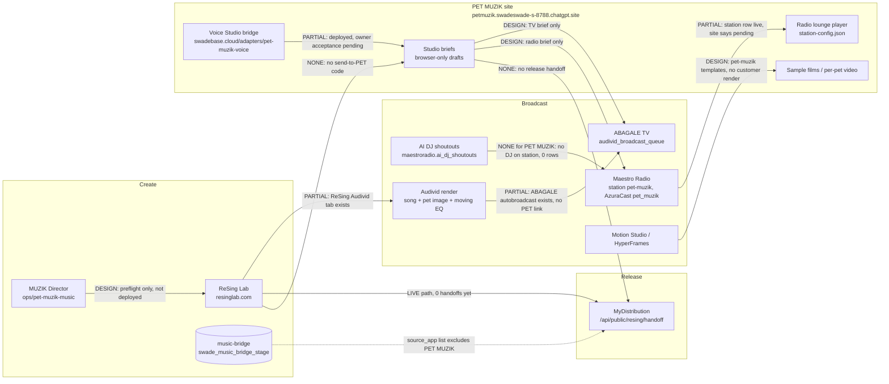

# PET MUZIK Ecosystem Map — 2026-10-28

Read-only audit, written ~6:00–7:00 PM America/Chicago, Oct 28 2026. No code, config, key, deploy or Lovable changes. Key values were never read out; only variable names are listed.
Status legend: LIVE = verified working end to end · PARTIAL = pieces exist but are not joined · DESIGN = documented/planned only · NONE = nothing found.

## Diagram

## Plain-English walkthrough

1. **ReSing Lab → PET MUZIK — NONE.** ReSing Lab makes songs, but nothing sends a song from ReSing into PET MUZIK. The ReSing source on swadesoul (/opt/swadebase/src-resing) and GitHub have no PET MUZIK code. The shared music-bridge only accepts the apps resinglab, mydistribution, maestroradio and maestroradiofactory (docker/volumes/functions/music-bridge/handler.ts line 12), so PET MUZIK can't be a source or destination yet. The PET MUZIK site has no backend calls apart from the voice bridge. The MUZIK Director agent (ops/pet-muzik-music/director.mjs) is a side-effect-free preflight module that only advises on `resinglab_generate_music`. It isn't deployed or called.
2. **PET MUZIK → MyDistribution — NONE (ReSing → MyDistribution does exist).** MyDistribution has a real intake endpoint at POST /api/public/resing/handoff (GitHub swadesoul/my-distribution src/routes/api/public/resing/handoff.ts). It's protected by the RESING_BRIDGE_SECRET header secret and writes to resing_release_handoffs with status pending. It accepts ReSing releases only. On swadesoul, mydistribution.resing_release_handoffs = 0 rows, release_intakes = 2 and release_submission_attempts = 0. The bridge tables workflow_handoffs and music_asset_links are both 0. PET MUZIK has no release button, endpoint or key. The site states "No order, payment, generation, submission or broadcast has been sent."
3. **Maestro Radio → PET MUZIK — PARTIAL.** A station row exists: maestroradio.stations slug pet-muzik (created 2026-10-28 06:36 UTC). It's status live, private, automated, on AzuraCast station 3 with shortcode pet_muzik and an icecast stream URL under radio.themaestroradio.com/listen/pet_muzik/. The PET MUZIK site still serves station-config.json with status=pending and stream_url=null, so the lounge player stays off, and the Bible says the stream is unverified. The stream wasn't probed today because that check's approval expired. **Shoutouts:** swade-radio has a DJ Studio shoutout feature (src/features/dj-studio/rules.ts, SHOUTOUT_LIMIT 200 chars, manager roles only) and the table maestroradio.ai_dj_shoutouts. That table has 0 rows in total, and no AI DJ is assigned to the PET MUZIK station. Nothing on PET MUZIK collects or shows shoutouts. The radio studio mode only builds a local airplay brief.
4. **Per-pet videos — DESIGN.** The site shows two fixed sample MP4s (Sheriff Husky and the Husky/Snowy memorial). The Motion Studio integration contract (docs/PET_MUZIK_MOTION_INTEGRATION_2026-10-27.md) is marked "PLANNED — no PET MUZIK render or integration deployed". There are HyperFrames templates at hyperframes-adapter/engine/pet-muzik-pop and pet-muzik-cartoon, but no per-customer video pipeline, order or delivery.
5. **Audivid → ABAGALE TV — PARTIAL (not linked to PET MUZIK).** Audivid code exists in swadesoul/audivid, videosaywhat, theleaguesound, abagale and in ReSing (src/pages/resinglab/Audivid.tsx, ResinglabAudividTab). The edge functions include audivid-generate, abg-render-audivid, abg-music-attach-audivid and abg-audivid-autobroadcast. abg-audivid-autobroadcast schedules into audivid_broadcast_assets and audivid_broadcast_queue per ABAGALE channel. The audivid schema has 2 audivids. None of this mentions PET MUZIK, there's no PET MUZIK ABAGALE channel or package, and the pet-photo-plus-moving-EQ "pet Audivid" product is not built. PET MUZIK's TV mode only makes a local brief.

## Keys (names only; values never printed)
Present in the SWADEBASE functions env: SUNO_API_KEY, RESING_MIX_WORKER_URL, RESING_MIX_WORKER_TOKEN, BACKBLAZE_KEY_ID, BACKBLAZE_APPLICATION_KEY, BACKBLAZE_BUCKET_NAME, BACKBLAZE_REGION, BACKBLAZE_S3_ENDPOINT, MOTION_B2_PREFIX, ABAGALE_STT_*, ABAGALE_*_WEBHOOK_SECRET, ABAGALE_PUBLIC_ORIGIN.
In the MyDistribution app (Lovable/GitHub code): RESING_BRIDGE_SECRET. Whether it's set wasn't checked; the code only references it.
PET MUZIK Printify: PET_MUZIK_PRINTIFY_API_TOKEN found earlier in Coolify shared env (see the Master Bible §12).
Not found anywhere: no PET MUZIK ↔ ReSing, PET MUZIK ↔ MyDistribution, PET MUZIK ↔ ABAGALE or PET MUZIK shoutout key or adapter. maestroradio.azuracast_config has no row for the PET MUZIK station. adapters_registry (20 rows) has no PET MUZIK, Audivid, radio or distribution adapter, only resing-mix-worker.

## What each link needs (no build approved yet)
- ReSing → PET MUZIK: a PET MUZIK adapter (per the adapter rule) and adding `petmuzik` to music-bridge APPS through a reviewed migration. Also needs a customer identity/OnePass on PET MUZIK, a server-side song inbox plus player, and rights/consent records.
- PET MUZIK → MyDistribution: a server-side release handoff, either a new PET source on /api/public/resing/handoff or via music-bridge `create_handoff` intent=release. Also needs a release secret held on SWADEBASE, rights attestation, payment/entitlement, and ISRC/metadata handling.
- Maestro Radio → PET MUZIK: verify the pet_muzik stream, then set station-config.json to verified with its URL. Also needs an AI DJ assigned to the station, a shoutout intake on PET MUZIK (consent, moderation, 200-char limit) writing to ai_dj_shoutouts, and radio-use authorization.
- Per-pet video: a Motion Studio/HyperFrames adapter job per approved pet, plus B2 readback, QA and private delivery.
- Audivid → ABAGALE TV: a pet Audivid template (song + pet photo + movable EQ), a PET MUZIK ABAGALE channel, and package/entitlement wiring. Each broadcast needs separate publication consent.

Evidence sources: live site and app.js (fetched 2026-10-28), /workspace/petmuzik earlier audit captures, swadesoul DB read-only queries, /opt/swadebase files cited above, GitHub swadesoul/my-distribution and swadesoul/swade-radio, and Lovable projects ReSing 691e8717, My Distribution a30b1397, Abagale TV 09c6de04 and TLS 9cf26a8d (Audivid). No PET MUZIK Lovable project exists.
