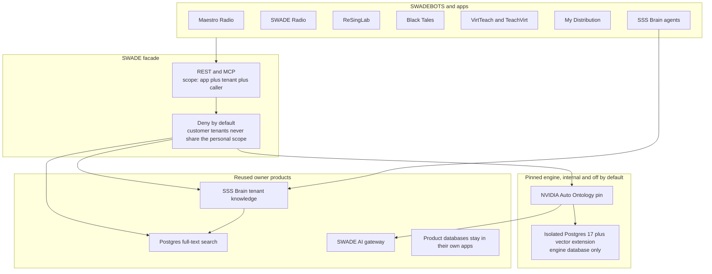

# SWADE architecture

SWADE is the shared meaning layer. SWADEBOTS agents and product apps ask SWADE. They do not open the Auto Ontology engine, the SWADEBASE platform database, or another tenant's SSS Brain.

The service id is `swade-ontology`. The user-facing name is SWADE. A bare `swade` identifier would collide with the SWADE AI gateway.

## What each part owns

| Part                      | Owns                                                       | Does not own                                     |
| ------------------------- | ---------------------------------------------------------- | ------------------------------------------------ |
| SWADE facade              | App grants, tenant class, audit, provenance, starter terms | Product rows, customer documents, personal notes |
| Auto Ontology pin         | Future compile and certify path for platform schemas       | Tenant isolation, model spend, document search   |
| SSS Brain                 | Per-tenant documents and memories, with its own RLS        | Shared term definitions                          |
| SWADE AI gateway          | The only model transport. Free callers use `auto/offline`  | NVIDIA hosted keys                               |
| Postgres full-text search | Unstructured platform refs and course-source retrieval     | The engine's vector index                        |
| Personal scope            | Tenant id `swade-personal` only                            | Any customer credential                          |

## Read path

1. The caller presents a SWADEBOTS or app credential. The credential binds `app_id`, `tenant_id`, `tenant_class`, and `plan`.
2. The facade rejects a missing credential, a service-role token, a tenant override, a personal-scope marker from a customer, and any term the app was not granted.
3. A matching question returns starter term definitions and SQL attributes. Those expressions are marked not executable. This service does not run them against product databases.
4. When `SWADE_AI_GATEWAY_URL` is set, a narration may be requested from that gateway once. A gateway error is returned as an error. There is no second provider.
5. Document search uses SSS Brain when `SSS_BRAIN_SEARCH_URL` is set, and drops any hit whose tenant id is not the caller's. Otherwise it searches the isolated full-text index. Customer corpora are not copied into the catalog.

## Isolation

- One platform catalog describes shared entities: Track, Artist, Station, Spin, Attribution, Order, Royalty, Consent, Course, Lesson, Exam, Source, Tenant, and Book.
- Maestro Radio, SWADE Radio, and ReSingLab see radio terms. Black Tales also sees Consent and Book. TeachVirt and VirtTeach see course terms. My Distribution and SSS Brain see order, royalty, consent, and tenant. The personal app sees the platform terms only inside `swade-personal`.
- Relationships that point at an ungranted term are omitted.
- The personal tenant cannot be stored on a customer credential, and a personal credential cannot name a customer tenant.

## Engine pin

`engine/PIN` records NVIDIA Auto Ontology commit `8ede47f7b67bf2612c5322c7a9adb8e0c6190e38`, Apache-2.0. The default Coolify file does not build or start that engine. The engine database is a separate Postgres instance and is the only place a vector extension is allowed. The facade migration does not create one.
